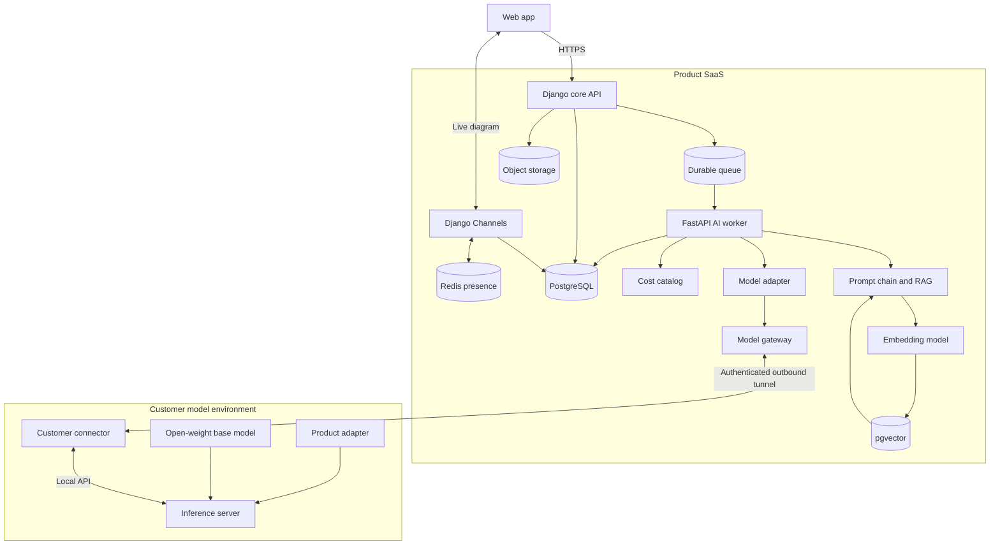
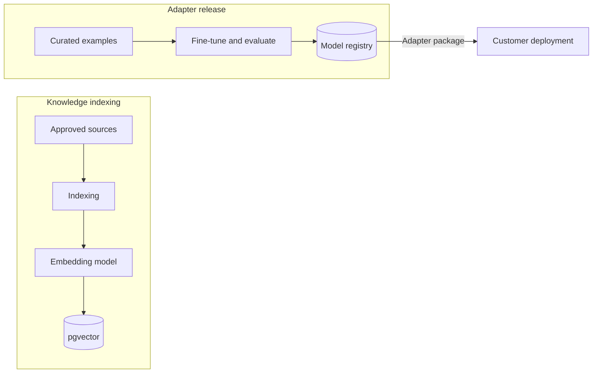

# System Architecture Assistant — High-Level Design

**Status:** Draft for review\
**Requirements baseline:** [Approved requirements](requirements.md), approved 2026-11-21\
**Scope:** Architecture for the System Architecture Assistant product itself. This HLD does not design a user's separate system.\
**Alignment:** Reconciled with the later workspace/session and API decisions on 2026-11-24. See [API design](service-plans/api-design.md) and [core database model](service-plans/database-model.md). Unresolved contracts are listed consistently in those documents.

**Approval gate:** LLD generation must wait until this HLD is approved by the workspace owner or designated approver.

## Decisions approved during discussion

| Pointer | Approved decision |
|---|---|
| Hosting model | V1 is a SaaS application. A customer-managed application deployment is out of V1 scope. |
| Service boundaries | V1 uses a modular core API plus separate real-time collaboration and AI worker processes. Core product features remain modules in one application rather than separate microservices. |
| Backend frameworks | Django owns the modular core product API and its product data/authentication workflows. FastAPI is used for the separate AI orchestration service. Real-time collaboration runs separately using Django Channels and the selected Yjs-compatible provider, subject to the production validation recorded below. |
| Collaboration framework/provider | Run Django Channels as a separately scalable collaboration process and use `pycrdt-websocket` for Yjs-compatible document synchronization. Treat the provider as a candidate subject to production validation of browser interoperability, persistence, authorization, and scale-out behavior before launch. |
| Frontend and canvas | Use a React and TypeScript single-page app built with Vite. Use React Flow with custom architecture nodes and connections for a structured, collaborative whiteboard with an open-canvas feel. |
| Model selection and low-cost development | Use Qwen3-4B Q4_K_M as a local development candidate for testing the harness and retrieval on the available 4 GiB GPU, with CPU/RAM offload if needed. This is not the selected customer-hosted V1 base model. Select that model family only after evaluating architecture-task quality and serving compatibility; consider one-time GPU compute only if evaluation shows it is needed. |
| AI knowledge and model layer | V1 includes RAG over a vector store, task-specific prompt orchestration, and fine-tuning using product-curated architecture examples. Customer project context is not included in training unless explicitly consented to. |
| Data separation | PostgreSQL stores customer workspace records; a vector store holds product-curated RAG knowledge; a model artifact registry stores fine-tuned model versions and training metadata; Redis is limited to ephemeral coordination. Training data is separate from customer workspace data by default. |
| V1 vector store | Use pgvector in PostgreSQL for the product-curated knowledge corpus, separated logically from customer workspace records through distinct schemas, access paths, and permissions. A dedicated vector service is not required for V1. |
| RAG embeddings | Run one product-operated, versioned open-weight embedding model in SaaS for both curated-knowledge indexing and project retrieval queries. Store only product-curated knowledge vectors; project query embeddings are transient. |
| Prompt orchestration | Use task-specific prompt chains for requirement review, architecture review, HLD, LLD, and cost guidance. Chains retrieve context, produce structured drafts with rationale and sources, validate workflow/traceability, and never bypass approval gates. |
| Training data governance | Fine-tuning uses only product-curated material cleared for this use, such as product-authored examples and synthetic scenarios. Customer workspace data is excluded unless explicitly opted in. Training runs record data/model versions and evaluation results before release. |
| Model release gate | Each model release is evaluated for requirement-gap quality, source/requirement grounding, HLD/LLD coherence and workflow compliance, context-aware cost guidance, and clear explanations. Dataset/model/knowledge/prompt versions are recorded; a human approves releases, with numeric thresholds set before launch. |
| Training and inference workloads | Fine-tuning/evaluation runs as a separate batch workload from live inference serving. Model artifacts are versioned and promoted to serving after evaluation and human approval. |
| V1 model hosting | The SaaS runs the product's RAG and orchestration layer. Customers host the supported base model with the product's compatible fine-tuned adapter. The SaaS sends inference requests and task-scoped workspace context to the configured customer-hosted endpoint. |
| Model endpoint connectivity | V1 uses a customer-side connector beside the model. The connector opens an outbound authenticated connection to a SaaS model gateway and forwards inference requests to the private model endpoint. No inbound public model port is required; the browser never calls the model. |
| Model endpoint configuration | V1 stores one owner-managed model connection per workspace, bound to a customer-side connector and supported model deployment. The SaaS validates connectivity and capabilities. Each workspace represents one architecture effort; there are no separate project overrides in V1. |
| Model endpoint failure | Connector or model failures leave existing artifacts unchanged, provide a visible job status and retry path, and never trigger a silent switch to another model/provider. Owners can explicitly change the workspace model connection. |
| Diagram collaboration | Use a Yjs-based shared document through a collaboration service operated inside the SaaS. The whiteboard UI remains a separate layer; the application preserves and surfaces semantic conflicts that require a human decision. |
| Model package deployment | The product trains and publishes a versioned adapter for one supported base-model family. Customers obtain the matching base model under its license and deploy the base-plus-adapter package in their environment. The SaaS validates endpoint/model compatibility; customers choose when to install updates. |
| Scaling boundary | The SaaS scales its API, collaboration, orchestration, and embedding workloads. Customers manage inference capacity for their hosted model; SaaS reports connector and request health but does not autoscale customer infrastructure. |
| Monitoring and alerting | SaaS operations monitor application, collaboration, queue, database, export, RAG/embedding, and training health. Workspace owners see connector and model endpoint status/latency/errors. Logs exclude raw prompts, diagrams, outputs, and credentials. |
| Knowledge and training sources | RAG uses versioned product-authored principles and official technical material cleared for use, with provenance/citation metadata. Fine-tuning uses product-authored and synthetic examples. Customer content and sources without clear usage rights are excluded from V1 training/indexing. |
| Deployment shape | V1 is a containerized, one-region SaaS using managed PostgreSQL, Redis, queue, and object storage. Fine-tuning uses on-demand GPU batch jobs. The customer model and inference capacity remain in the customer's environment. |
| Recovery baseline | V1 requires durable database backups with point-in-time recovery, versioned object artifacts, and tested restoration. Numeric RPO/RTO targets are set before launch; active-active multi-region is out of V1 scope. |
| SaaS tenancy | V1 uses shared SaaS infrastructure with workspace-scoped records and connector settings, application authorization on each request, and PostgreSQL row security as defense in depth. Product knowledge is shared; customer project context and embeddings remain workspace-scoped and are not added to the shared index. |
| Cost guidance | Compare total cost drivers, including infrastructure, usage, operational effort, support/SLA, compliance, and scaling. Show numeric estimates only when user-provided rates or versioned price sources are available, and include region, currency, workload assumptions, and source date. |

## 1. Design goals

- Clarify and approve requirements before generating HLD, then require HLD approval before generating LLD.
- Keep AI recommendations reviewable and non-mutating until a user approves a change.
- Provide an architecture-specific knowledge and orchestration layer that works with existing models, including at least one self-hosted model in V1.
- Support collaborative diagram editing without losing work, and expose unresolved semantic conflicts for the team to resolve.
- Protect workspace data, make model data flow visible, and keep workspace data out of model training unless users explicitly consent.
- Scale the API, collaboration path, and AI workloads independently as demand becomes measurable.

## 2. Proposed architecture

### Runtime and collaboration

### Knowledge and model lifecycle

All SaaS components emit operational telemetry to monitoring and alerting. Logs exclude raw prompts, diagrams, generated outputs, and secrets.

### Component responsibilities

| Component | Responsibility |
|---|---|
| Browser client | Requirement intake and review, collaborative diagram canvas, HLD/LLD review, approvals, comments, and exports. The client renders proposals separately from approved artifacts. |
| Core application API | Workspace sessions, invitations, and authorization; workspace model endpoint settings; requirement versions; workspace and diagram metadata; comments; AI job requests; approval records; document versions; and export requests. |
| Realtime collaboration gateway | A separately scalable Django Channels process using `pycrdt-websocket` for authenticated shared diagram sessions, concurrent updates, presence, and persistence of diagram changes. It checks the user's active workspace session before admitting edits and on access changes. A short-lived ticket authorizes connection establishment; leaving or access removal ends collaboration access. Production use is gated on validation of provider interoperability, persistence, authorization, and scale-out behavior. |
| AI orchestration workers | Run requirement review, gap analysis, architecture review, cost option comparison, HLD generation, and LLD generation as separate versioned workflows. They retrieve relevant knowledge, assemble task-scoped workspace context through task-specific prompt chains (submitted drafts for review; approved inputs for design generation), call model adapters, validate outputs, and persist results as drafts. |
| Cost and service data catalog | Stores versioned pricing and service attributes used for comparisons, including source, effective date, region, currency, and workload units. Numeric estimates are omitted or clearly qualified if this data is unavailable or stale. |
| Architecture knowledge layer | Holds product-maintained system design and architecture principles in a versioned vector store and retrieves relevant material for each task. V1 project context is limited to approved requirements for design generation and the selected in-app design; requirement review may inspect a submitted draft without treating it as approved. Team documents and imported diagrams are excluded until V2 privacy/PII requirements are defined. |
| Embedding model | A product-operated, versioned open-weight model generates vectors for curated knowledge and transient project retrieval queries. The same embedding version is used to create and query the index. Project queries are not added to the curated corpus. |
| Model training and evaluation pipeline | Trains a product-owned architecture adapter (such as LoRA) on one supported open-weight base model using product-curated architecture examples, evaluates candidate versions, and publishes the compatible adapter package. Customers obtain the matching base model under its license and deploy the pair. Customer workspace data stays outside this pipeline unless explicitly consented to. |
| Model artifact registry | Stores approved adapter versions, base-model compatibility metadata, training/evaluation metadata, and rollback versions. It is separate from customer project storage. |
| Model adapter boundary | Normalizes supported model calls, endpoint authentication, capabilities, structured output, timeouts, and errors. V1 connects to the supported customer-hosted base-plus-adapter endpoint through the SaaS model gateway. Each additional model family may need its own adapter. |
| Model connection gateway and connector | A SaaS gateway routes per-workspace inference jobs over a customer-initiated authenticated tunnel. A small customer-side connector forwards requests to the local model server; it does not expose a public model port. |
| PostgreSQL | Source of truth for workspaces, per-user workspace sessions, invitations, requirements and their revisions, approvals, comments, document versions, audit events, and durable collaboration snapshots/updates. |
| Redis | Ephemeral presence and fan-out/pub-sub support for collaboration nodes; rate limiting and short-lived coordination. It is not the source of truth for workspace artifacts. |
| Durable job queue | Decouples longer AI and export operations from interactive requests. Jobs have status, bounded retries, idempotency keys, and a visible failure state. |
| Object storage | Stores generated PDF artifacts and other binary exports. Access is authorized through the application and scoped to the owning workspace. |
| Observability | Collects service health, latency, error rates, queue depth, collaboration connection health, and per-workspace connector/model request health. Logs avoid raw prompts, secrets, and sensitive workspace content. |

## 3. Primary workflow and approval gates

1. A user submits a free-form description and any known requirements, technologies, scale, budget, data, and compliance constraints. Unknown values remain explicitly unknown.
2. The requirement reviewer asks focused questions, flags ambiguity/conflicts/gaps, and proposes edits or additional requirements. Suggestions are separate from the requirement record.
3. The user edits and approves a versioned requirements brief. Only approved requirements become eligible context for design generation.
4. Team members create or edit the architecture diagram. Compatible concurrent changes merge; semantically conflicting edits to the same design item are preserved and shown for human resolution.
5. The HLD workflow uses the approved requirements version and selected diagram version, plus the product-owned architecture knowledge layer. It stores an HLD draft with assumptions, rationale, tradeoffs, and links back to its source requirements/design elements.
6. The workspace owner or designated approver reviews and approves the HLD. Until approval, it remains a draft and no LLD generation starts.
7. After an explicit client request, the LLD workflow uses the approved HLD and pinned source versions. HLD approval does not automatically start LLD generation. It stores a versioned LLD draft for review. AI-suggested modifications never overwrite approved artifacts without explicit approval.
8. A specific draft or approved HLD/LLD revision can be exported as PDF or Markdown. The export labels its revision and approval state. The HLD export includes its associated architecture diagram. Export generation is asynchronous and clients poll for completion.

When a requirement or diagram changes after HLD approval, the prior HLD remains available as an approved historical version. The system marks downstream designs as potentially stale and proposes review; it does not silently rewrite the HLD or LLD.

### API and persistence contract

- Browser REST requests go to Django Core; diagram sync uses the separate collaboration service. FastAPI orchestration, RAG, the model gateway, and connector protocols are internal service boundaries, not direct browser model APIs.
- Core validates active-session access and source revisions before queuing generation or export. Those operations return `202 Accepted` and an operation identifier; the browser polls the workspace-scoped generation/export resource. Durable operation records must survive worker restarts. Requirements/diagram AI review also runs through the worker boundary; its public completion contract is still open.
- HLD uses an approved requirements revision and selected diagram snapshots. LLD uses the approved HLD and its source versions. Generated revisions retain these inputs and model/prompt/knowledge versions. History is workspace-owned and outlives a participant leaving.
- Recommendation requests retain the requesting session; acceptance/rejection retains the deciding session separately. Acceptance creates a new draft revision, leaving the source intact. The resulting document revision requires its own approval.
- Requirements and HLD/LLD REST saves use `base_revision_id`; concurrent stale saves return `409 Conflict`. Accepted diagram updates are saved continuously; reviewable snapshots are created periodically and before AI review. Presence is transient.
- The API document defines common errors, cursor pagination, and idempotent generation/export/decision requests. Model onboarding/health contracts, access-removal mechanics, and AI-review completion remain explicitly open; they are required V1 coverage, not removed features.

## 4. AI knowledge and orchestration

The product-owned architecture intelligence layer is independent of the base model. V1 combines three approved capabilities:

- **RAG:** A versioned vector store holds product-maintained system-design and architecture principles. The orchestrator retrieves relevant knowledge for each task.
- **Fine-tuning:** A training pipeline adapts one supported open-weight base model using product-curated architecture examples, evaluates candidate versions, and publishes a compatible base-plus-adapter package for customers to host.
- **Prompt orchestration:** Task-specific prompt chains coordinate requirement review, design review, HLD, LLD, and cost guidance, and validate output structure before saving a draft.
- **Cost option analysis:** The cost workflow compares operating costs, workload, operational effort, support/SLA, compliance, and scaling assumptions. Numeric estimates require user rates or versioned price data and carry source dates and assumptions.
- **Project context:** The current workspace's approved requirements and in-app diagram are assembled at inference time for V1. Team documents and imported diagrams remain out of scope until V2 privacy/PII requirements are defined.

RAG provides updateable, traceable knowledge; fine-tuning adapts model behavior from curated examples; prompt orchestration selects task context and instructions. The exact fine-tuning method, training schedule, hardware, and evaluation thresholds remain open HLD details.

Training and retrieval use product-curated sources. Customer requirements and diagrams are excluded from fine-tuning unless explicitly consented to. Model calls run through adapters to the customer's configured inference endpoint for the supported base-plus-adapter package. The orchestrator records which adapter/model, model version, prompt-chain version, and knowledge version were used for each generated artifact, while keeping endpoint credentials out of workspace records and logs. Users can see which configured endpoint receives project context. Provider slowness or failure leaves the workspace artifact unchanged, returns a clear job status and retry path, and never silently switches providers.

## 5. Data boundaries and security

- One workspace represents one architecture effort. Shared requirements, diagrams, and HLD/LLD revisions belong to the workspace through their parent artifacts. Users participate through one persistent session per `(workspace_id, user_id)`; that session has an `is_active` flag. The Core API resolves it from the authenticated account and workspace UUID. V1 has no separate Project or Membership entity.
- Model connections are configured by the workspace owner and bound to a workspace-specific connector. The connector initiates the authenticated tunnel; no inbound public model port is required. Connection secrets are encrypted and redacted from logs.
- Only active workspace sessions can access content or perform workspace actions. Approvals and recommendation decisions require the existing owner/designated-approver permission and retain the submitting session. First-time workspace creation also creates the owner's active session without an invite. Invites for other users are account-bound, reusable, and non-expiring. Explicit leave deactivates the session; a temporary network disconnect only changes presence. Permanent access removal must also prevent invite-based reactivation; the removal API and storage representation are still open. Finer-grained role permissions are V2.
- PostgreSQL is the canonical data store. Database row-level security is a defense-in-depth control for tenant isolation, in addition to application authorization; its policies require careful design and verification. [PostgreSQL row security documentation](https://www.postgresql.org/docs/current/ddl-rowsecurity.html)
- Only the minimum task-scoped workspace context needed for a task is sent over the connector to the configured customer-hosted model. The product shows this data flow and does not use customer workspace content to train underlying models or share it across workspaces without explicit consent.
- Data sensitivity, jurisdiction, retention, and compliance constraints are captured per workspace. The assistant may suggest applicable considerations; users decide what applies. The system flags unsupported or unconfirmed requirements and does not claim compliance without evidence.
- V1 model context excludes uploaded team documents and imported diagrams. These require a separate V2 PII and privacy design.
- Use encrypted transport, encrypted managed storage, secret management, short-lived signed export access, and redacted operational logs. Exact retention periods and hosting boundary remain open decisions.

## 6. Collaboration and conflict handling

**Approved direction:** represent the diagram as a shared document and use Yjs as the V1 CRDT collaboration layer over an authenticated WebSocket provider operated inside our SaaS. Yjs provides shared types that merge concurrent updates and has a separate awareness mechanism for presence; its documentation recommends choosing a server-backed provider for real-world deployments rather than using the public demo server. [Yjs collaborative editor guide](https://docs.yjs.dev/getting-started/a-collaborative-editor), [Yjs awareness and presence](https://docs.yjs.dev/getting-started/adding-awareness)

CRDT merge alone does not guarantee that every semantically incompatible edit is obvious to a user. The diagram domain should preserve edit history and detect overlapping changes to the same logical component/property where possible. The UI then displays both values and requests a human resolution. Presence data is ephemeral; diagram state and reviewable snapshots are durable. Diagram snapshots do not require a separate approval state.

## 7. Scalability and operations

- Keep core API handlers stateless so API instances can scale horizontally.
- Scale AI workers independently by queue depth, provider limits, and model capacity. Apply bounded retries, idempotency, and backpressure to prevent a provider outage from creating an unbounded queue.
- Scale realtime gateways independently; use Redis or an equivalent shared pub/sub layer to fan updates across gateway instances. Persist document updates/snapshots outside Redis.
- Monitor customer connector heartbeats and model request latency/errors per workspace. SaaS can report endpoint health from its request path but cannot autoscale customer-operated inference capacity.
- Keep PostgreSQL as the canonical source of truth. Begin with a high-availability managed or self-managed primary and backups; add read scaling/partitioning only when measured workload requires it.
- Use managed PostgreSQL backups with point-in-time recovery, version model/export artifacts in object storage, and regularly verify restoration. Rebuild the vector index from curated source material when needed. Numeric recovery objectives remain a production launch gate.
- Run the self-hosted model endpoint separately from the web/API tier so GPU and inference capacity can scale or be constrained independently.
- Alert on elevated API and collaboration failures, model timeouts/errors, queue age/depth, export failures, and storage/database health. Do not log raw sensitive prompts to diagnose failures.
- Capacity targets (workspaces, concurrent collaborators, artifact sizes, availability, and response latency) must be set before production launch; they remain open in the approved requirements.

## 8. Candidate technology profile

These are HLD recommendations, not final implementation approvals:

| Area | Candidate | Reason and tradeoff |
|---|---|---|
| Web client and canvas | React and TypeScript single-page app built with Vite; React Flow with custom architecture nodes and connections | Provides a client-centered, interactive canvas while producing static assets that can be served alongside the Django API. Structured nodes/connections support architecture-aware AI review and semantic conflict detection. [React Flow custom nodes](https://reactflow.dev/learn/customization/custom-nodes), [Vite production build](https://vite.dev/guide/build) |
| Backend frameworks | Django for the modular core API; FastAPI for the separately deployable AI orchestration service | Keeps product records and core workflows in Django while isolating the AI request/orchestration path. FastAPI does not replace the durable job queue. The browser client and collaboration service remain separate boundaries. |
| Core database | PostgreSQL | Relational records fit workspaces, approvals, revisions, and audit history; JSON can store versioned diagram/document payloads where appropriate. Row security can add a database-enforced tenant boundary, with careful policies. |
| Vector store | pgvector in PostgreSQL, in a separate logical schema for product-curated knowledge | Keeps V1 infrastructure smaller while retaining a clear data boundary. pgvector supports exact and approximate vector search; a separate vector service remains an option if measured load or isolation needs justify it. |
| Embeddings | A product-operated open-weight embedding model, versioned with the vector index | Keeps indexing and query vectors compatible and avoids requiring every customer-hosted generative model to expose an embedding API. The model family and hardware remain technical choices. |
| Collaboration | Django Channels plus `pycrdt-websocket` in a separately scalable Python process | Selected HLD direction for Yjs-compatible sync. The library currently labels itself beta, so validate browser interoperability, persistence, authorization, and scale-out before launch. Snapshot and update strategy remain LLD decisions. [Django Channels](https://channels.readthedocs.io/en/stable/introduction.html), [pycrdt-websocket](https://y-crdt.github.io/pycrdt-websocket/), [package metadata](https://github.com/y-crdt/pycrdt-websocket/blob/main/pyproject.toml) |
| Cache/presence | Redis or compatible service | Useful for transient presence, pub/sub, rate limits, and coordination; not the durable artifact store. |
| Async work | Durable queue plus separate workers | Isolates AI latency and retries from interactive API requests. Queue vendor is deployment-dependent. |
| Export storage | S3-compatible or equivalent object storage | Keeps PDF and binary artifacts out of the transactional database; provider choice is deployment-dependent. |
| Model runtime and training | Customer-hosted serving for one supported open-weight base model plus product-trained adapter, reached through a customer-side outbound connector; product runs a separate curated-data training/evaluation pipeline and publishes approved adapter artifacts. vLLM is a reference runtime candidate. Qwen3-4B Q4_K_M is only a local development candidate. | Lets customers keep model serving in their environment without exposing a public inference port. Fine-tuning is limited to the supported base family; other model endpoints need compatible adapters and may not support the product-trained adapter. The customer-hosted model family remains open pending quality and serving evaluation. |
| Cost and service data | Versioned provider pricing and service metadata with source/effective date, region, currency, and usage units | Supports conditional estimates and transparent comparisons. Provider data updates and freshness thresholds remain an operational design choice. |

## 9. Key tradeoffs and open decisions

1. **Self-hosted model/runtime:** Select the first supported open-weight base model and qualify it with the reference inference server after evaluating architecture-task quality, structured output, privacy, latency, and customer hardware cost. Qwen3-4B Q4_K_M is a local development candidate only, not the customer-hosted V1 model selection. The outbound customer connector is approved; its protocol, onboarding, and authentication details remain for LLD.
2. **Training data and evaluation:** Define the licensed/provenanced architecture examples, evaluation tasks, quality thresholds, and safe rollout/rollback process for fine-tuned model versions.
3. **Vector corpus details:** Define knowledge source provenance, chunking, metadata, embedding model family, and index configuration in the LLD.
4. **Collaboration provider validation:** Confirm browser interoperability, persistence, authorization, scale-out behavior, and operational maturity for `pycrdt-websocket` before launch.
5. **Collaboration persistence details:** Choose update batching, snapshot strategy, and semantic conflict detection details in the LLD.
6. **Production objectives:** Set capacity and availability targets before production launch.
7. **V2 inputs:** Select import formats and define PII handling before accepting external diagrams or team documents.
8. **Compliance suggestions:** Define which authoritative sources and frameworks the knowledge layer recognizes; requirements are selected by each workspace's users.

### Remaining API alignment work

The [API open-contract register](service-plans/api-design.md#required-contracts-still-open-in-all-design-documents) is the shared list of remaining V1 contracts: AI review completion, model/connector management, permanent access removal, creator reactivation after leave, approval administration, operation storage, and exact payload/provenance details. The core ERD supplies a draft logical representation; detailed permission flags and source-link fields remain reviewable design choices. These open items do not change the established Core/collaboration/AI service split.

## References

- [React Flow custom nodes](https://reactflow.dev/learn/customization/custom-nodes)
- [Vite production build](https://vite.dev/guide/build)
- [Yjs collaborative editor guide](https://docs.yjs.dev/getting-started/a-collaborative-editor)
- [Yjs awareness and presence](https://docs.yjs.dev/getting-started/adding-awareness)
- [Django Channels](https://channels.readthedocs.io/en/stable/introduction.html)
- [pycrdt-websocket](https://y-crdt.github.io/pycrdt-websocket/)
- [pycrdt-websocket package metadata](https://github.com/y-crdt/pycrdt-websocket/blob/main/pyproject.toml)
- [PostgreSQL row security policies](https://www.postgresql.org/docs/current/ddl-rowsecurity.html)
- [Hugging Face PEFT documentation](https://huggingface.co/docs/transformers/peft)
- [vLLM OpenAI-compatible server](https://docs.vllm.ai/en/latest/serving/openai_compatible_server/)
- [vLLM LoRA adapters](https://docs.vllm.ai/en/latest/features/lora/)
