# V1 Core Database — ER Review

**Status:** Review candidate, consolidated under the user's delegation. No ORM models or migrations have been created.

**Scope:** 13 core tables for accounts, workspaces, participation, requirements, diagrams, HLD/LLD history, pinned sources, and comments. AI recommendations, model/training/vector records, durable jobs, and exports remain required service-specific V1 planning outside this core diagram. Django framework-owned authentication/permission tables are also omitted.

[Complete ER diagram — zoomable SVG](../diagrams/database/core.svg) · [Editable Mermaid source](../diagrams/database/core.mmd) · [Schema and decision register](database-model.md)

## Relationship overview

The overview omits attributes and cross-type target edges for readability. The complete diagram contains every core column and relationship. Focused views below repeat shared tables intentionally; they do not introduce duplicate tables.

## 1. Accounts and workspace participation

- One persistent session per `(workspace_id, user_id)`.
- Workspace `ref_id` is the reusable shared joining reference; there is no separate invitation table or additional public UUID.
- Access requires an enabled account, an active session, and `revoked_at IS NULL`.
- The owner is a session, established atomically with the workspace. A partial unique index permits at most one owner; owner revocation is blocked.

[Mermaid source](../diagrams/database/access.mmd)

## 2. Documents, diagram working state, and history

- Workspace creation initializes one requirements parent and two design parents: `hld` and `lld`. These parents initially have zero revisions.
- First save/generation creates revision 1. Saves append complete immutable JSONB requirements or Markdown design content.
- Diagrams are created on request, with working state and an empty revision 1 at update sequence 0.
- Binary working state/updates recover the current collaborative diagram. Complete JSONB diagram revisions independently preserve historical versions.
- `source_update_seq` is a durable boundary marker, not a foreign key to compactable update rows.
- Document kind is enum `hld | lld`; diagram kind is enum `architecture | environment`.

[Mermaid source](../diagrams/database/artifacts.mmd)

## 3. Exact source versions for HLD and LLD

Exactly one of `requirements_revision_id`, `diagram_revision_id`, or `source_design_revision_id` is populated per source row. An HLD can reference requirements and several diagram snapshots through separate rows. An LLD references its selected HLD; that HLD's immutable links pin the upstream requirements and diagrams.

Source links are immutable and saved atomically with their owning revision. Manual edits copy the base revision's links by default. Explicitly changing sources creates a new revision. All records must belong to the same workspace. There are no approval records or sign-off prerequisites.

[Mermaid source](../diagrams/database/sources.mmd)

## 4. Revision comments and one-level replies

Exactly one target revision FK is populated per comment. The author is a workspace session. Replies reference a root comment and inherit its target revision and optional anchor; replies to replies are not supported in V1. Comments remain attached to their original revision and retain attribution when the author leaves.

[Mermaid source](../diagrams/database/comments.mmd)

## Reading the diagrams

- `PK`: primary key; `FK`: foreign key; `UK`: single-column unique constraint.
- `PK, FK` on `diagram_working_state.diagram_id` makes it a one-to-one child. Both `PK` attributes in `diagram_update` form its composite primary key.
- Fields annotated `nullable` permit null; other displayed columns are non-null. `varchar_200`, for example, denotes `VARCHAR(200)`.
- A circle at a relationship end means optional; a crow's foot means many; a bar means one. Dotted relationships are non-identifying; solid ones include the parent identity in the child's primary key.
- Compound unique constraints, exactly-one-target checks, nonblank-content checks, and tenant/role rules are listed in the [database decision register](database-model.md#indexes-and-constraints-discussed-so-far), rather than being implied by individual `UK` markers.
- Exactly two design-parent kinds and the initial owner/requirements parent are established by the atomic creation workflow. The ER notation and unique constraints alone do not enforce those minimum counts.
- Core validates workspace consistency across references; ordinary FKs alone do not prove it. PostgreSQL row-security/enforcement SQL still needs implementation validation.

The [delegated structural decisions](database-model.md#delegated-core-structural-decisions--review-candidate) select initialization, first-save behavior, diagram categories, JSON shape, computed staleness, comment limits, owner return, and revoked-list visibility. Historical FKs are protected; only owned diagram working state/updates cascade on deliberate diagram deletion. Operational purge/retention and service-specific schemas remain separate work.
