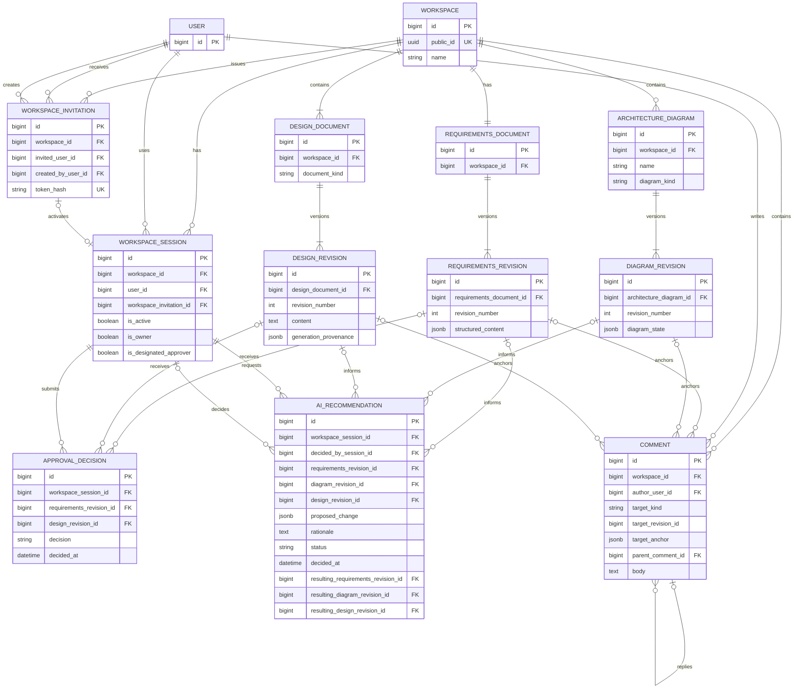
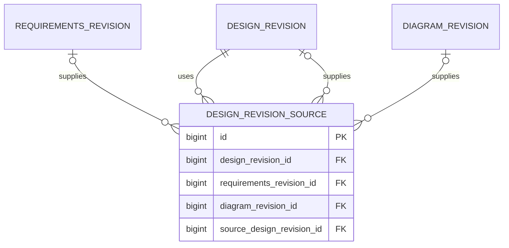

# V1 Core Database Model

**Status:** Discussion draft for review\
**Scope:** Core workspace, architecture content, and collaboration relationships. No migrations or ORM models are approved.

This draft records the decisions discussed so far. It intentionally leaves service-specific AI, model, training, cost, and queue tables for later planning.

**Alignment:** Reconciled on 2026-11-24 with the [HLD](../hld.md) and [API design](api-design.md). Fields below are a logical draft representation of the agreed behavior, not an implementation approval. Service-specific records still required for V1 are identified below rather than implied to be absent from the product.

## Agreed modeling decisions

- One workspace represents one architecture effort. V1 does not need a separate Project entity.
- A workspace can have multiple sessions, with one session per user per workspace. A user can have sessions in multiple workspaces.
- A session is the user's temporary participation link to a workspace. It has an `is_active` flag: joining creates or activates it, exiting deactivates it, and rejoining through the same invite activates it again.
- Each user has one reusable invite per workspace. Invites are bound to that user's account and do not expire.
- Workspace creation atomically creates the creator's active owner session. That initial session does not require an invitation.
- Use `BIGINT` internal primary and foreign keys, with a separate unique UUID for a workspace's public reference. The UUID identifies the workspace but does not grant access.
- A workspace has one structured requirements document with revision history. V1 does not store the original prompt separately.
- A workspace can have multiple diagrams. Diagram state (nodes, connections, layout, and properties) is JSON. Each diagram has revision history scoped to the workspace through its parent diagram.
- Each workspace has one HLD document and one LLD document, each with revision history scoped to the workspace through its parent document.
- AI recommendations are requested through the user's active workspace session and refer to the source revision they concern. Accepting one creates a new revision.
- Approval decisions are submitted through an active workspace session and refer to the exact requirements or design document revision being approved.
- Comments attach to specific content.
- There is no separate persisted per-user context buffer in V1. The shared workspace is enough.

## Core ER diagram

## Relationship notes

- `WORKSPACE_SESSION` connects exactly one user to exactly one workspace. Enforce one session per `(workspace_id, user_id)`.
- The session's `is_active` flag tracks whether that user is currently participating. Leaving sets it to false; using the same invite to rejoin sets it to true.
- A network disconnect does not deactivate a session; online presence is separate. Session records remain available to preserve historical approvals and recommendation decisions.
- A `WORKSPACE_INVITATION` is tied to one workspace and one specific user. It is reusable, does not expire, and is separate from the public workspace UUID. First redemption creates that user's workspace session; later redemptions reactivate it.
- Enforce one invitation per `(workspace_id, invited_user_id)`, one session per `(workspace_id, user_id)`, and at most one session per non-null `workspace_invitation_id`. The invitation link is nullable for the creator's initial session; invited collaborators reference an invite for the same workspace and user.
- Draft permission representation: exactly one session per workspace is its owner (`is_owner`); designated approval authority uses `is_designated_approver`. Both approval paths still require `is_active`. These flags implement the existing V1 rule; configurable role entities remain V2. Ownership transfer and designation-management contracts remain open.
- Revisions belong to workspace-owned requirements, diagrams, or design documents. They do not reference a user's session; their workspace scope comes through the parent artifact.
- Enforce one requirements document per workspace with a unique `workspace_id`.
- Enforce one HLD and one LLD per workspace with a unique pair of `(workspace_id, document_kind)`; `document_kind` is HLD or LLD.
- Enforce unique revision numbers within each parent document or diagram.
- Only an active workspace session can submit an approval or request AI review. The session links the action to its user and workspace.
- An approval row references exactly one requirements or design revision. HLD approval is the prerequisite for LLD generation. The session and target revision must belong to the same workspace, and the existing V1 owner/designated-approver rule still applies.
- A recommendation references exactly one source revision and the session that requested it. Accepting it does not mutate that source revision; it creates a new revision after approval.
- `workspace_session_id` on a recommendation is the requester; `decided_by_session_id` is the separate, nullable deciding session. Pending recommendations have no decision metadata. A rejection records the decider and time without a resulting revision; acceptance records exactly one resulting revision of the corresponding artifact type. Every referenced session, source, and result must belong to the same workspace. The draft models one final accept/reject decision per recommendation; re-opening is not defined.
- A diagram revision stores the editable graph as JSON. Uploaded image files, if introduced, should be stored outside PostgreSQL with references in the database.
- Comment targets are shown conceptually in this ERD. The physical foreign-key strategy for cross-type anchors is still open.

## Generated design source links

Each generated HLD/LLD revision must retain its exact inputs. One revision may use multiple diagram snapshots, so a single diagram foreign key is insufficient. The following logical association complements the core ERD:

Each source row references exactly one requirements, diagram, or upstream design revision in the same workspace; duplicate source links are disallowed. HLD generation pins approved requirements and selected diagram snapshots; LLD pins an approved HLD and its source versions. A design must not depend on itself or create a source cycle. `generation_provenance` records the model/base-adapter, prompt-chain, and knowledge versions used, without credentials. Exact provenance fields remain a service contract detail.

Changes to a source can make downstream designs potentially stale; prior approvals remain historical facts. The dependency links enable that check. Whether staleness is computed on read or materialized remains open. Manual revision saves must define whether they retain or update source links during payload planning.

## Required V1 supporting records, deferred to service planning

- Durable generation, AI review, and export operation records, including requesting session, workspace, fixed inputs, status, result references, and failure metadata; retry/idempotency and outbox records
- Customer model connection and connector records
- Product knowledge, vector index, and training records
- Cost catalogs and estimates
- Realtime presence or transient collaboration connection state

These are V1 requirements, not features deferred to V2. The generation and export polling APIs depend on these records. Their physical schemas and internal service contracts remain open.

## Shared unresolved contracts

- Permanent access removal must prevent an old reusable invite from reactivating the session; `is_active = false` alone only represents leaving. Invite revocation/access-block storage and API are not finalized.
- AI-review completion/status delivery, model configuration and connector onboarding/health, operation/idempotency storage, and exact provenance fields are still open in the API design as well.
- Comments currently store a user author resolved through the active session. If historical session attribution is required for comments too, the author representation needs an explicit decision.
- The creator's reactivation path after leaving needs a contract because the initial owner session has no invite prerequisite. Collaborator reactivation continues to use the reusable invite.
