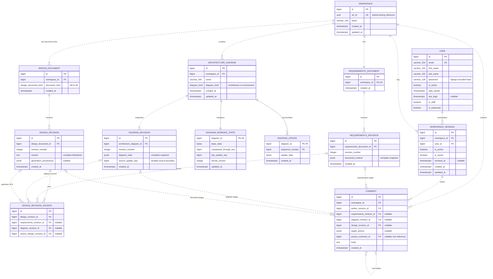
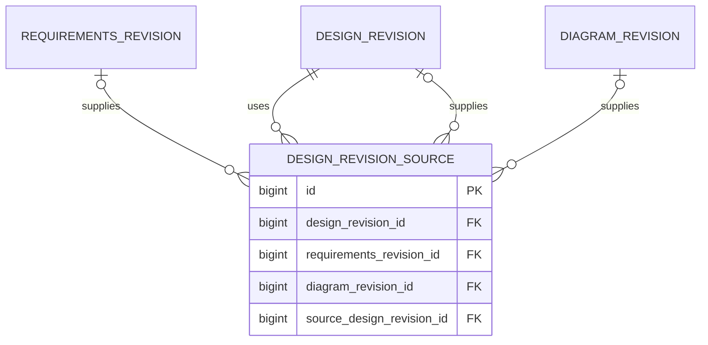
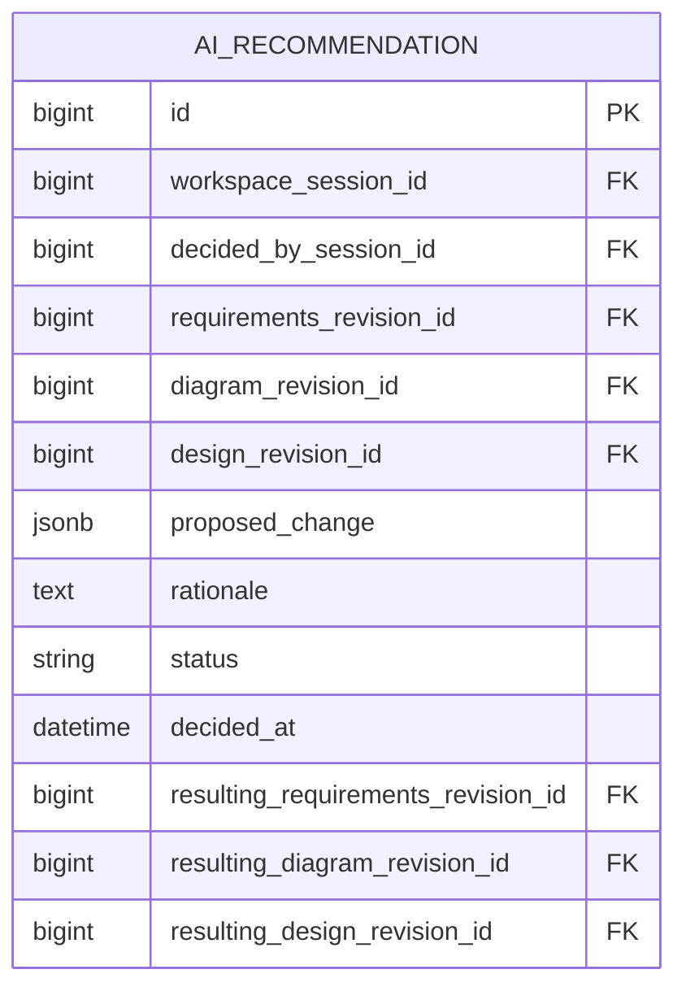

# V1 Core Database Model

**Status:** Consolidated core schema review candidate; delegated structural decisions recorded below\
**Scope:** Core workspace, architecture content, and collaboration relationships. No migrations or ORM models are approved.

This review candidate records the decisions discussed so far and the remaining core structural choices delegated by the user. The [dedicated ER review](database-erd.md) provides readable diagrams and exports. It intentionally leaves service-specific AI, model, training, cost, and queue tables for later planning.

**Alignment:** Reconciled on 2026-11-24 with the [HLD](../hld.md) and [API design](api-design.md). Fields below are a logical draft representation of the agreed behavior, not an implementation approval. Service-specific records still required for V1 are identified below rather than implied to be absent from the product.

## Agreed modeling decisions

- V1 uses email/password accounts through a custom Django user model configured before the first migration. Email is the login identifier; there is no separate username. Social login is deferred. Account identity is separate from per-workspace participation.
- One workspace represents one architecture effort. V1 does not need a separate Project entity.
- A workspace can have multiple sessions, with one session per user per workspace. A user can have sessions in multiple workspaces.
- A session is the user's participation link to a workspace. Joining creates or activates it, exiting sets `is_active = false`, and rejoining through the shared link activates the same session only when `revoked_at IS NULL`.
- Permanent per-account workspace removal stores a nullable `workspace_session.revoked_at` timestamp and sets `is_active = false`. Retain the session for attribution; the current or a replacement shared link cannot reactivate it. Only the active owner can remove another participant; block revoking the owner.
- A workspace stores one reusable UUIDv4 `ref_id` used in its shared joining link. Any enabled signed-in account possessing the current link can join unless its workspace session is revoked. There is no separate invitation table or account-bound invitation record.
- Workspace creation atomically creates the creator's active owner session. That initial session does not require the shared link.
- Use `BIGINT` primary and foreign keys. `workspace.ref_id` is the joining reference; there is no additional `public_id` UUID. Ordinary workspace access still requires authentication and an active workspace session.
- A workspace has one structured requirements document with revision history. Each saved revision is a complete, immutable JSONB snapshot, not an activity-log entry or a delta. V1 does not store the original prompt separately.
- A workspace can have multiple diagrams. Live work is persisted as Yjs-compatible binary updates with periodic consolidation of the working state. Separately, each diagram revision holds a complete, immutable JSONB graph snapshot for historical viewing and source references. Both are workspace-scoped through their parent diagram.
- Each workspace has one HLD document and one LLD document, each with revision history scoped to the workspace through its parent document.
- Design revisions retain immutable source links to exact inputs. Manual edits copy their base revision's source links by default; replacing sources requires an explicit change and a new revision, not silently following newer inputs.
- AI recommendations are requested through the user's active workspace session and refer to the source revision they concern. Accepting one creates a new revision.
- Formal product approval is removed. Requirements, HLD, and LLD evolve through revisions without approval records, approval states, or designated approvers. Generation pins explicitly selected saved inputs; applying an AI suggestion remains an explicit edit action through an active workspace session.
- Comments attach to exact requirements, diagram, or HLD/LLD revisions through explicit foreign keys. Authors are attributed through their workspace sessions. V1 comments are append-only, with one level of replies inheriting the root comment's revision and optional anchor.
- Historical foreign-key relationships use protected deletion. Cascading is limited to a diagram's owned working-state/update records when its diagram is deliberately deleted. Temporary leave and account disablement retain stored content and attribution; deliberate data deletion and retention workflows remain separate planning.
- There is no separate persisted per-user context buffer in V1. The shared workspace is enough.

## Core ER diagram



## Relationship notes

- `WORKSPACE_SESSION` connects exactly one user to exactly one workspace. Enforce one session per `(workspace_id, user_id)`.
- The session's `is_active` flag tracks whether that user is currently participating. Leaving sets it to false; using the workspace's current shared joining link sets it to true, provided access has not been permanently removed.
- `revoked_at` is null for ordinary participation/temporary leave and a server-recorded timestamp for permanent access removal. A revoked session must be inactive. In this document, an authorized active workspace session also requires an enabled account and `revoked_at IS NULL`; the activity flag alone never grants access.
- A network disconnect does not deactivate a session; online presence is separate. Session records remain available to preserve comment authorship and historical recommendation requests and decisions.
- `workspace.ref_id` is shared by participants, reusable, and non-expiring. It is not a one-time token. Generate it using UUIDv4. Replacing it invalidates the previous joining link without removing existing sessions. Treat it as a joining credential, not an ordinary public identifier.
- Enforce one session per `(workspace_id, user_id)`. Joining must create or reactivate the row atomically; it must preserve existing permissions and never grant ownership implicitly.
- Exactly one session per workspace is its owner (`is_owner`). A partial unique index enforces at most one owner, including inactive owners; atomic workspace creation establishes the initial owner. Ownership remains for workspace administration, not document sign-off. All active participants can edit and apply/reject AI suggestions. Configurable role entities remain V2; ownership-transfer contracts remain open. There is no designated-approver field.
- Revisions belong to workspace-owned requirements, diagrams, or design documents. They do not reference a user's session; their workspace scope comes through the parent artifact.
- Enforce one requirements document per workspace with a unique `workspace_id`.
- Enforce one HLD and one LLD per workspace with a unique pair of `(workspace_id, document_kind)`. The agreed PostgreSQL enum `design_document_kind` restricts the non-null `document_kind` to lowercase `hld` or `lld`, matching the API values. `workspace_id` remains a `BIGINT` foreign key.
- Enforce unique revision numbers within each parent document or diagram.
- Only an active workspace session can request AI review or apply/reject a recommendation. The session links the action to its user and workspace; no document approval is required.
- A recommendation references exactly one source revision and the session that requested it. Explicitly accepting/applying it does not mutate that source revision; it creates a new revision without a separate approval step.
- `workspace_session_id` on a recommendation is the requester; `decided_by_session_id` is the separate, nullable deciding session. Pending recommendations have no decision metadata. A rejection records the decider and time without a resulting revision; acceptance records exactly one resulting revision of the corresponding artifact type. Every referenced session, source, and result must belong to the same workspace. The draft models one final accept/reject decision per recommendation; re-opening is not defined.
- A diagram revision stores the editable graph as JSON. Uploaded image files, if introduced, should be stored outside PostgreSQL with references in the database.
- Comments use exactly one of `requirements_revision_id`, `diagram_revision_id`, or `design_revision_id`. The author session, target, root/reply, and explicit `workspace_id` must agree on workspace scope. Optional anchor payload formats remain open, but the revision foreign keys and session-based authorship are agreed.

## Agreed user/account schema

Use a custom Django user model with email as its login identifier and no separate username. Set the custom user model before the first migration; Django manages account/password behavior rather than a parallel custom authentication implementation. `USER` is the logical ERD entity; its concrete ORM/table mapping will be chosen during implementation. [Django custom-user guidance](https://docs.djangoproject.com/en/stable/topics/auth/customizing/#using-a-custom-user-model-when-starting-a-project).

| Column | PostgreSQL type or Django-managed field/default | Nullable | Meaning |
|---|---|---|---|
| `id` | `BIGINT` generated identity, primary key | No | Stable account identity |
| `email` | `VARCHAR(254)`, unique | No | Canonical email login identifier |
| `first_name` | `VARCHAR(150)`, default empty string | No | Optional display information |
| `last_name` | `VARCHAR(150)`, default empty string | No | Optional display information |
| `password` | Django-managed encoded password field | No | Password hash and hashing metadata, never a raw password |
| `is_active` | `BOOLEAN`, default `true` | No | Whether the account is enabled across the product |
| `date_joined` | `TIMESTAMPTZ`, current time on creation | No | Account creation time |
| `last_login` | `TIMESTAMPTZ`, initially null | Yes | Most recent login; maintained through the authentication workflow |
| `is_staff` | `BOOLEAN`, default `false` | No | Django administration access flag |
| `is_superuser` | `BOOLEAN`, default `false` | No | Django administrative permission flag |

### Email identity and indexes

- Adopt a case-insensitive email identity policy for V1: trim and lowercase the complete email consistently on registration, email change, and login. This is the product's chosen identity policy, not a claim that all mail providers treat local parts identically.
- Enforce a nonblank canonical stored value with `email = lower(btrim(email))` and `char_length(email) > 0`, plus the unique email constraint. Validate email format in the account workflow; the canonical-storage check alone does not validate an address.
- The unique email constraint supplies the login lookup index. Do not add a duplicate email index, a separate lower-email index on already canonical data, or initial indexes on names, activity flags, and login timestamps.
- Use Django's password-setting/checking APIs and password validation. Do not assign raw passwords to the stored field or expose its encoded value in API responses. The specific hasher configuration remains implementation planning. [Django password management](https://docs.djangoproject.com/en/stable/topics/auth/passwords/).

### Account state versus workspace participation

`user.is_active` controls whether the account may access the product; `workspace_session.is_active` controls participation in one workspace. Workspace-content access requires an enabled account, that account's active workspace session, and `revoked_at IS NULL`. Account disablement must block existing as well as new product access; cross-process/login-session invalidation details still need an authentication contract. Disabling an account does not erase workspace content, session history, or comment authorship.

`is_staff` and `is_superuser` are Django administrative flags, not workspace ownership or automatic customer-content access. Product REST and collaboration paths must still enforce workspace-session authorization.

The account schema does not create a second user/workspace relationship: `workspace_session.user_id` references this stable account ID. Authentication/login sessions are distinct from workspace-session rows. Exact login transport, account endpoints, email verification/change/recovery, account deletion/retention, and related framework-owned records remain open. Social-provider identities/tables are deferred beyond V1. No ORM model or migration is created by this schema decision.

## Agreed workspace and session columns

All listed columns are non-null except `workspace_session.revoked_at`, which defaults to null. Internal IDs are generated `BIGINT` identities. Foreign-key deletion follows the [agreed protection rules](#agreed-foreign-key-deletion-rules); temporary leave must not delete a session or its historical actions.

| Table | Column | PostgreSQL type/default | Meaning |
|---|---|---|---|
| `workspace` | `id` | `BIGINT` identity, primary key | Internal workspace identity |
| `workspace` | `ref_id` | `UUID`, backend-generated UUIDv4, unique | Shared joining reference |
| `workspace` | `name` | `VARCHAR(200)` | Display name; duplicates across workspaces allowed |
| `workspace` | `created_at` | `TIMESTAMPTZ`, current timestamp on insert | Creation time |
| `workspace` | `updated_at` | `TIMESTAMPTZ`, current timestamp on insert | Last workspace metadata change |
| `workspace_session` | `id` | `BIGINT` identity, primary key | Persistent participation identity |
| `workspace_session` | `workspace_id` | `BIGINT`, foreign key | Owning workspace |
| `workspace_session` | `user_id` | `BIGINT`, foreign key | Participating account |
| `workspace_session` | `is_active` | `BOOLEAN`, default `true` | Participation status, separate from online presence |
| `workspace_session` | `is_owner` | `BOOLEAN`, default `false` | Owner authority |
| `workspace_session` | `revoked_at` | Nullable `TIMESTAMPTZ`, default `NULL` | Server-recorded permanent workspace access-removal time |
| `workspace_session` | `created_at` | `TIMESTAMPTZ`, current timestamp on insert | First join/creation time |
| `workspace_session` | `updated_at` | `TIMESTAMPTZ`, current timestamp on insert | Last participation or permission change |

The backend maintains `updated_at` after insertion; a SQL default alone does not update it. Editing a diagram or document does not update the workspace metadata timestamp.

### Agreed workspace-session revocation

| Participation state | `is_active` | `revoked_at` | Shared-link behavior |
|---|---|---|---|
| Participating | `true` | `NULL` | Keep the existing session active |
| Temporarily left | `false` | `NULL` | Reactivate the same session |
| Access removed | `false` | Removal timestamp | Refuse reactivation, including through a replacement link |

The active owner can remove another participant in the same workspace by setting `is_active = false`, recording `revoked_at`, and maintaining `updated_at`. Preserve the row and its attribution. Block removal of the owner; ownership transfer remains a separate contract. Collaborators cannot remove themselves permanently through this owner action; ordinary Leave remains the existing reversible action.

Coordinate owner authorization, joining/reactivation, and removal transactionally on the relevant session records. A shared-link join must check the existing row's revocation marker rather than blindly setting it active. Ordinary joining and leaving never clear `revoked_at`. Removal must terminate collaboration access and block subsequent REST, ticket, WebSocket, and suggestion actions. Exact cross-process invalidation, in-flight write coordination, and request/response details remain service-contract work.

Enforce `revoked_at IS NULL OR is_active = false` and `is_owner = false OR revoked_at IS NULL`. These checks prevent active revoked sessions and owner revocation. No new revocation index is needed: the unique `(workspace_id, user_id)` constraint locates the participant row before checking its fields.

Owner-authorized restoration is not part of normal joining and has no agreed route yet. Exact owner removal routes, error payloads, and ownership transfer remain open; revoked-list visibility and owner return are selected below, and there is no participant-facing restoration flow in the initial core implementation; this decision adds one column and no new table.

## Indexes and constraints discussed so far

Primary keys and unique constraints supply their supporting indexes; do not add duplicate indexes on the same keys. [PostgreSQL constraints](https://www.postgresql.org/docs/current/ddl-constraints.html).

| Table | Constraint/index | Query or rule |
|---|---|---|
| `user` | Primary key `(id)`; unique `(email)` | Account identity and canonical email login lookup |
| `user` | Check canonical nonblank email | Stored value equals `lower(btrim(email))` and has positive length |
| `workspace` | Primary key `(id)` | Internal workspace lookup |
| `workspace` | Unique `(ref_id)` | Resolve the joining link |
| `workspace` | Check `char_length(btrim(name)) > 0` | Reject blank names |
| `workspace_session` | Primary key `(id)` | Reference the acting session |
| `workspace_session` | Unique `(workspace_id, user_id)` | One session per account/workspace; authorization lookup |
| `workspace_session` | B-tree `(user_id, id)` | User's workspace listing ordered by session ID |
| `workspace_session` | Unique `(workspace_id) WHERE is_owner = true` | At most one owner regardless of activity |
| `workspace_session` | Check `revoked_at IS NULL OR is_active = false` | Revoked sessions cannot be active |
| `workspace_session` | Check `is_owner = false OR revoked_at IS NULL` | Owner cannot be revoked |
| `requirements_document` | Primary key `(id)`; unique `(workspace_id)` | One requirements document per workspace |
| `requirements_revision` | Primary key `(id)`; unique `(requirements_document_id, revision_number)` | Exact revision and ordered history |
| `requirements_revision` | Check `revision_number > 0` | Positive revision numbers |
| `requirements_revision` | Check `jsonb_typeof(structured_content) = 'object'` | Complete requirements JSON is an object; Core validates schema version/fields |
| `architecture_diagram` | Primary key `(id)`; B-tree `(workspace_id, id)` | Diagram lookup and workspace diagram listing |
| `architecture_diagram` | Native `diagram_kind` enum; nonblank `VARCHAR(200)` name | Architecture/environment category and usable display name |
| `diagram_revision` | Primary key `(id)`; unique `(architecture_diagram_id, revision_number)` | Exact snapshot and ordered history |
| `diagram_revision` | Check `revision_number > 0` | Positive revision numbers |
| `diagram_revision` | Check `source_update_seq >= 0` | Nonnegative durable source boundary; not a foreign key to compactable updates |
| `diagram_working_state` | Primary key/foreign key `(diagram_id)` | One working-state row per diagram |
| `diagram_working_state` | Check `0 <= compacted_through_seq AND compacted_through_seq <= last_update_seq` | Valid consolidation boundary |
| `diagram_working_state` | Check `format_version > 0` | Positive format identifier |
| `diagram_update` | Composite primary key `(diagram_id, sequence_number)` | Unique per-diagram update order; ordered recovery reads |
| `diagram_update` | Check `sequence_number > 0` | Positive update sequence |
| `design_revision` | Primary key `(id)`; unique `(design_document_id, revision_number)` | Exact revision lookup and ordered HLD/LLD history |
| `design_revision` | Check `revision_number > 0` | Positive revision numbers |
| `design_revision` | Check nonblank `content` | Prevent saving an empty HLD/LLD body as authored content |
| `design_revision_source` | Primary key `(id)`; B-tree `(design_revision_id)` | Source-link identity and all sources of a design revision |
| `design_revision_source` | Check exactly one of the three nullable source FKs is non-null | One source per link row |
| `design_revision_source` | Unique `(requirements_revision_id, design_revision_id)` where `requirements_revision_id IS NOT NULL` | No duplicate requirement links; find affected designs from a requirements revision |
| `design_revision_source` | Unique `(diagram_revision_id, design_revision_id)` where `diagram_revision_id IS NOT NULL` | No duplicate diagram links; find affected designs from a diagram revision |
| `design_revision_source` | Unique `(source_design_revision_id, design_revision_id)` where `source_design_revision_id IS NOT NULL` | No duplicate upstream-design links; find dependent LLD revisions |
| `comment` | Primary key `(id)`; B-tree `(workspace_id, id)` | Exact comment and ordered workspace comment listing |
| `comment` | B-tree `(parent_comment_id, id)` | Ordered replies to a root comment |
| `comment` | B-tree `(author_session_id)` | Attribution and referenced-session protection lookups |
| `comment` | B-tree `(requirements_revision_id, id)` where `requirements_revision_id IS NOT NULL` | Comments attached to an exact requirements revision |
| `comment` | B-tree `(diagram_revision_id, id)` where `diagram_revision_id IS NOT NULL` | Comments attached to an exact diagram snapshot |
| `comment` | B-tree `(design_revision_id, id)` where `design_revision_id IS NOT NULL` | Comments attached to an exact HLD/LLD revision |
| `comment` | Check exactly one target-revision FK is non-null; nonblank `body` of at most 8,000 characters | Valid target and bounded comment content |
| `comment` | Check `target_anchor IS NULL OR jsonb_typeof(target_anchor) = 'object'` | Optional structured anchor; Core validates its keys and target |

User/account, workspace/session, HLD/LLD revision/source-link, comment, and working-state/update indexes are agreed, along with the diagram revision's source boundary. Requirements and diagram parent/revision index choices are consolidated for review under the delegated decisions below. Do not initially add standalone boolean, content-search, or JSONB GIN indexes: current access paths locate records by account, workspace, document, diagram, or revision. Review ORM-generated foreign-key indexes for duplication when migrations are planned. No additional update ID or separate `(diagram_id)` index is needed for the update access paths already covered by its composite primary key.

Requirements saves must check `base_revision_id` and insert the next revision atomically while serializing saves on the parent document. A unique revision number alone does not implement the stale-base check. Workspace creation initializes the empty parent document; the delegated structural decisions below define first-save and JSON behavior for review.

## Agreed HLD/LLD document-kind enum

Use a native PostgreSQL enum for `design_document.document_kind`:

```sql
CREATE TYPE design_document_kind AS ENUM ('hld', 'lld');
```

The column is `document_kind design_document_kind NOT NULL`. This replaces the proposed `VARCHAR(3)` plus an allowed-values check; the enum enforces the allowed labels. Keep the unique `(workspace_id, document_kind)` constraint so each workspace can have at most one document of each kind. The enum does not replace `workspace_id` or its foreign key.

The SQL above is a design example, not an executed migration. [PostgreSQL enum documentation](https://www.postgresql.org/docs/current/datatype-enum.html). The agreed source-link constraints and manual-edit inheritance are recorded in [Generated design source links](#generated-design-source-links).

## Agreed HLD/LLD revisions and Markdown content

Both document kinds use `design_revision`. Each save stores the complete Markdown document as an immutable `TEXT` snapshot; historical viewing reads that snapshot directly. No delta reconstruction or additional content-format column is required for V1.

| Column | PostgreSQL type/default | Nullable | Meaning |
|---|---|---|---|
| `id` | `BIGINT` generated identity, primary key | No | Exact revision identity |
| `design_document_id` | `BIGINT`, foreign key | No | Parent HLD or LLD document; workspace is inherited through the parent |
| `revision_number` | `INTEGER` | No | Positive sequential version within the document |
| `content` | `TEXT` | No | Complete Markdown content |
| `generation_provenance` | `JSONB` | Yes | Model/base-adapter, prompt, and knowledge versions for directly AI-generated content; exact payload remains AI service-planning work |
| `created_at` | `TIMESTAMPTZ`, current timestamp on insert | No | Revision creation time |

Enforce unique `(design_document_id, revision_number)` and `revision_number > 0`. The unique index supports history and latest-revision lookup; no initial full-text or JSONB index is required. Revisions have no `updated_at` or session foreign key: saved content remains immutable and workspace-owned. The latest revision is simply the latest saved content; there is no draft/approved lifecycle, final decision, or approval table. Any saved revision can be selected for generation or export with the existing active-session checks.

For manual saves, resolve the active session for authorization, lock the parent document, verify the submitted `base_revision_id` is still current, and insert the next revision in one transaction. A stale base returns `409 Conflict`. Parent initialization and first-save behavior are defined in the delegated decisions below. Concurrent publication of AI results remains AI service-contract work.

Manually authored revisions may use `generation_provenance = NULL`. A manual edit to generated content must not copy provenance in a way that claims the new text was directly generated. Its new source-link rows retain the base revision's pinned dependencies by default, as described below. This schema supports manual content/history before AI implementation; it does not finalize AI provenance fields or authorize migrations.

## Agreed hybrid diagram persistence

Two durable representations serve different purposes:

| Representation | Stored content | Purpose |
|---|---|---|
| Working collaboration state | Yjs-compatible binary updates and a periodically consolidated CRDT state | Recover and synchronize the current editable diagram, including edits newer than its latest revision |
| `diagram_revision.diagram_state` | Complete JSONB graph: nodes, connections, layout, and properties | Independently render an immutable historical version and pin AI/design inputs |

The collaboration service owns persistence of the merged working state. A browser must not overwrite that state with an independent last-writer-wins full JSON save. Yjs documents describe incremental binary updates, full-state encoding, and merging updates; this does not itself provide the product's browsable revision history. [Yjs document updates](https://docs.yjs.dev/api/document-updates).

### Agreed working-state and update columns

All columns below are non-null. Both `diagram_id` columns reference `architecture_diagram.id`; workspace scope is inherited through that diagram. Sequence numbers are assigned by the server per diagram, not by clients or a global database identity sequence.

| Table | Column | PostgreSQL type/default | Meaning |
|---|---|---|---|
| `diagram_working_state` | `diagram_id` | `BIGINT`, primary key and foreign key | Exactly one working-state row per diagram |
| `diagram_working_state` | `base_state` | `BYTEA` | Complete consolidated Yjs-compatible binary representation, initialized to a correctly encoded empty collaboration document |
| `diagram_working_state` | `compacted_through_seq` | `BIGINT`, default `0` | Highest update sequence included in `base_state` |
| `diagram_working_state` | `last_update_seq` | `BIGINT`, default `0` | Last committed update sequence; never reset during consolidation |
| `diagram_working_state` | `format_version` | `INTEGER`, default `1` | Application collaboration-document format identifier |
| `diagram_working_state` | `updated_at` | `TIMESTAMPTZ`, current timestamp on insert | Last update or consolidation; maintained by the backend |
| `diagram_update` | `diagram_id` | `BIGINT`, foreign key, part of primary key | Owning diagram |
| `diagram_update` | `sequence_number` | `BIGINT`, part of primary key | Server-assigned order of durable updates within the diagram |
| `diagram_update` | `update_data` | `BYTEA` | Persisted binary collaboration update or accepted batch |
| `diagram_update` | `created_at` | `TIMESTAMPTZ`, current timestamp on insert | Persistence time |

The composite primary key of `diagram_update` is `(diagram_id, sequence_number)`; it has no additional surrogate ID. Working-state initialization must accompany diagram creation atomically. Its diagram relationship and the working-state diagram relationship use the agreed owned-data cascade below. Deliberate deletion workflows and format migration/compatibility behavior remain to be finalized before migrations.

`diagram_revision` additionally stores non-null `source_update_seq BIGINT`: the durable update boundary used to produce its complete JSONB snapshot, with `0` representing the initial state. It is not an FK to `diagram_update`, because covered updates can be consolidated and removed. Creating a revision must verify its source boundary against that diagram's committed working state. A sequence marker identifies a source boundary but does not replace the historical JSON content.

### Edit, checkpoint, and read behavior

1. Validate authentication, active-session access, and the diagram's workspace before accepting edits.
2. In a short database transaction, lock the diagram's `diagram_working_state` row, assign the next per-diagram sequence, insert `diagram_update`, advance `last_update_seq`, and maintain `updated_at`. Commit before acknowledging the update/batch as saved. Concurrent persistence for the same diagram coordinates through that row; other diagrams use different rows. Redis/presence data is not the recovery source. Exact batching, retry handling, access-change coordination, and wire acknowledgements remain service-contract work. [PostgreSQL row locking](https://www.postgresql.org/docs/current/explicit-locking.html#LOCKING-ROWS).
3. Recover the current working document from `base_state` plus durable updates with `compacted_through_seq < sequence_number <= last_update_seq`. Read both from a consistent database view so consolidation cannot create a gap between reading the base and the updates. An open diagram can be newer than its latest historical snapshot; exact database isolation/query mechanics remain implementation planning.
4. Create complete JSONB revision snapshots periodically when content changed and before AI review. Pin a consistent committed boundary `S`, materialize the diagram through `S`, and record `source_update_seq = S` with the immutable JSONB snapshot. Concurrent later edits belong to subsequent working state, not that revision. The exact checkpoint/consolidation coordination protocol remains to be designed; reading an arbitrary in-memory document and attaching a sequence number is insufficient.
5. Historical viewing loads the selected revision's JSON directly in a read-only canvas. It neither replays collaboration updates nor changes the working diagram. Rollback remains outside this V1 history-viewing work.
6. Coordinate consolidation through the same per-diagram row lock. Publish the replacement `base_state`, advance `compacted_through_seq` to its covered boundary, and delete only covered update rows in one transaction, preserving `last_update_seq` and later updates. Failure rolls back the replacement, marker, and deletion together. Consolidation must not overwrite a newer committed base. Preserve all retained historical JSON snapshots; compaction must not rewrite a revision or break existing AI, comment, or design-source references. Merging CRDT updates is not equivalent to removing all deleted-content metadata.

The two table schemas, per-diagram sequence/locking approach, commit-before-acknowledgement rule, atomic consolidation, and revision source marker are agreed. Checkpoint interval, content-change detection, consolidation thresholds, cross-process checkpoint/access coordination, retries, format compatibility, and retention/deletion policies remain open. No automatic history pruning or migrations are approved; retention planning must account for referenced revisions.

## Generated design source links

**Status: source-link schema, dependency direction, and manual-edit inheritance agreed.** Each generated HLD/LLD revision must retain its exact inputs. One revision may use multiple diagram snapshots, so a single diagram foreign key is insufficient. The following association complements the core ERD:



### Agreed columns and validation

| Column | PostgreSQL type | Nullable | Meaning |
|---|---|---|---|
| `id` | `BIGINT` generated identity, primary key | No | Source-link identity |
| `design_revision_id` | `BIGINT`, foreign key to `design_revision.id` | No | Revision using the source |
| `requirements_revision_id` | `BIGINT`, foreign key to `requirements_revision.id` | Yes | Exact requirements revision |
| `diagram_revision_id` | `BIGINT`, foreign key to `diagram_revision.id` | Yes | Exact complete diagram snapshot |
| `source_design_revision_id` | `BIGINT`, foreign key to `design_revision.id` | Yes | Exact upstream HLD revision used by an LLD |

Each row must populate exactly one of the three source columns. The primary key, forward lookup index, and three partial unique indexes are listed above. Using the source ID first in each unique index supports looking up affected designs without adding a duplicate source-ID index.

Foreign keys ensure referenced revisions exist. All referenced records must also belong to the same workspace, and source types must follow the dependency direction below. Validate active-session access, workspace, source types, and duplicate links in the service transaction that creates the revision and all its source rows. Ordinary row-level `CHECK` constraints cannot validate facts in other table rows. [PostgreSQL constraint guidance](https://www.postgresql.org/docs/current/ddl-constraints.html).

### Dependency direction and immutable inputs

- An HLD references the explicitly selected saved requirements revision and selected diagram snapshots. There is no requirements-approval prerequisite for generation.
- An LLD references an explicitly selected saved HLD revision. Its requirements and diagram inputs are pinned transitively through that HLD's immutable source links; do not duplicate those rows merely to follow the same inputs. LLD generation requires an explicit request and an existing HLD revision, not HLD approval.
- Upstream design links therefore run from LLD to HLD. HLD source links point to requirements/diagrams, not other design documents. Reject self-dependencies and links outside this direction, preventing design-source cycles in V1.
- Create a revision and its complete source-link set atomically. Once saved, neither its content nor its source links are rewritten. A changed source set creates a new revision.

For directly AI-generated revisions, `generation_provenance` records the model/base-adapter, prompt-chain, and knowledge versions used, without credentials; manual revisions follow the nullable-provenance rule above. Exact provenance fields remain an AI service contract detail.

### Manual edits and potentially stale designs

When saving a manual edit, copy the base revision's source links into new rows belonging to the new revision by default. This means the document remains based on those exact inputs; it does not assert that the edited text was automatically checked against them. Do not automatically replace a reference with the latest requirements, diagram, or HLD version.

Changing sources requires an explicit choice, validated against the same workspace and allowed dependency direction, and creates a new content revision and source-link set together. Existing revisions remain unchanged; there is no subsequent approval step. Exact request fields, initial manually authored source selection, and detailed validation for explicit source changes remain payload-planning work.

Changes to a source can make downstream designs potentially stale, including an LLD reached through its HLD; historical revisions and their pinned sources remain available. The dependency links enable that check. Whether staleness is computed on read or materialized remains open. Source-link foreign keys use the agreed protected-deletion policy below; deliberate deletion and retention mechanics that preserve referenced revisions remain to be planned.

## Agreed comments and one-level replies

Use one `comment` table for requirements, diagram snapshots, HLD, and LLD comments and replies. This replaces the earlier draft's generic `target_kind`/`target_revision_id` and direct user-author reference.

| Column | PostgreSQL type/default | Nullable | Meaning |
|---|---|---|---|
| `id` | `BIGINT` generated identity, primary key | No | Comment identity |
| `workspace_id` | `BIGINT`, foreign key to `workspace.id` | No | Owning workspace and workspace-list scope |
| `author_session_id` | `BIGINT`, foreign key to `workspace_session.id` | No | Participating session that wrote the comment |
| `requirements_revision_id` | `BIGINT`, foreign key to `requirements_revision.id` | Yes | Exact requirements target |
| `diagram_revision_id` | `BIGINT`, foreign key to `diagram_revision.id` | Yes | Exact diagram snapshot target |
| `design_revision_id` | `BIGINT`, foreign key to `design_revision.id` | Yes | Exact HLD/LLD target |
| `target_anchor` | `JSONB` | Yes | Optional diagram component or document-section reference within the target revision |
| `parent_comment_id` | `BIGINT`, foreign key to `comment.id` | Yes | Root comment being replied to; null for a root |
| `body` | `TEXT` | No | Nonblank text |
| `created_at` | `TIMESTAMPTZ`, current timestamp on insert | No | Server-recorded creation time |

### Creation and thread rules

- Exactly one target-revision FK is populated. Real FKs enforce that the target exists; validate that the explicit workspace, target revision, and author session all belong to the same workspace.
- Resolve `author_session_id` from the authenticated account's active session. The client cannot nominate another author/session. Coordinate access validation and insertion transactionally; exact interaction with concurrent leave/removal is still service-contract work.
- Replies reference a root comment whose own `parent_comment_id` is null. There are no replies to replies in V1. Validate the parent is in the same workspace; reject self-parenting and nested-parent requests.
- A reply inherits its root's target revision and optional anchor. The backend copies those values from the root rather than allowing the reply to choose a different target. A root and all its replies therefore refer to the same content location.
- Comments are append-only for V1. Posting a reply does not change the root's content or anchor. No comment update/delete routes are introduced by this decision.
- Leaving or rejoining a workspace preserves the same session and existing comment attribution. New content revisions do not move old comments to the latest version; read them against their original revision.

The indexes and row-level checks are listed above. Comment foreign keys use the protected-deletion rules below. The delegated core decisions select an 8,000-character body limit and optional object anchors for nodes, edges, or document sections. Exact anchor validation/request fields, list/thread payloads and pagination, deliberate account-data removal, and retention remain API/operational work. These details do not reopen the agreed session author, explicit revision FKs, append-only behavior, or one-level reply model. No migrations are created by recording this schema.

## Agreed foreign-key deletion rules

**Status: protected historical relationships and limited owned-data cascading agreed.** The table lists planned Django `on_delete` behavior for the reviewed core relationships. Keep database foreign-key constraints enabled and inspect their generated DDL during migration planning; ORM deletion handling and database-native referential actions are separate implementation concerns. [Django deletion behavior](https://docs.djangoproject.com/en/stable/ref/models/fields/#django.db.models.ForeignKey.on_delete), [PostgreSQL foreign-key actions](https://www.postgresql.org/docs/current/ddl-constraints.html#DDL-CONSTRAINTS-FK).

Read each row as: deleting the referenced parent is blocked or cascades to the referencing child. This does not describe deleting the child directly.

| Referencing child column(s) | Referenced parent | Planned behavior | Reason |
|---|---|---|---|
| `workspace_session.user_id` | User/account | `PROTECT` | Preserve participation and authorship links |
| `workspace_session.workspace_id` | Workspace | `PROTECT` | Retain participation records until deliberate cleanup |
| `requirements_document.workspace_id` | Workspace | `PROTECT` | Prevent implicit removal of requirements |
| `architecture_diagram.workspace_id` | Workspace | `PROTECT` | Prevent implicit removal of diagrams |
| `design_document.workspace_id` | Workspace | `PROTECT` | Prevent implicit removal of HLD/LLD |
| `requirements_revision.requirements_document_id` | Requirements document | `PROTECT` | Preserve version history |
| `diagram_revision.architecture_diagram_id` | Diagram | `PROTECT` | Preserve complete diagram snapshots |
| `design_revision.design_document_id` | HLD/LLD document | `PROTECT` | Preserve saved document revisions |
| `design_revision_source.design_revision_id` | Owning design revision | `PROTECT` | Retain its exact dependency set |
| `design_revision_source.requirements_revision_id` | Requirements revision | `PROTECT` | Preserve a pinned input |
| `design_revision_source.diagram_revision_id` | Diagram revision | `PROTECT` | Preserve a pinned snapshot |
| `design_revision_source.source_design_revision_id` | Upstream HLD revision | `PROTECT` | Preserve the LLD's pinned HLD |
| `comment.workspace_id` | Workspace | `PROTECT` | Preserve workspace discussion |
| `comment.author_session_id` | Workspace session | `PROTECT` | Preserve author attribution |
| `comment.requirements_revision_id` | Requirements revision | `PROTECT` | Preserve the comment target |
| `comment.diagram_revision_id` | Diagram revision | `PROTECT` | Preserve the comment target |
| `comment.design_revision_id` | HLD/LLD revision | `PROTECT` | Preserve the comment target |
| `comment.parent_comment_id` | Root comment | `PROTECT` | Prevent removal of a root with replies |
| `diagram_working_state.diagram_id` | Diagram | `CASCADE` | Working state is owned by its diagram |
| `diagram_update.diagram_id` | Diagram | `CASCADE` | Working updates are owned by their diagram |

No `SET NULL` behavior is introduced for these relationships: silently removing a comment target or pinned source would undermine its meaning. The historical protections can block a diagram deletion before any owned-state cascade runs. The cascade is not a shortcut for deleting referenced diagram history.

### Access changes versus data deletion

- **Temporary leave:** set the existing workspace session inactive. Keep the session, content, source links, and comments.
- **Account disablement:** deny global account access without deleting the account's referenced records. This is not personal-data erasure.
- **Permanent workspace access removal:** retain the participation row for attribution, set it inactive, record `revoked_at`, and block shared-link reactivation. The field/behavior are agreed; exact owner action and invalidation protocol remain open. The activity flag alone only means temporary leave.
- **Deliberate workspace/account data deletion:** design an explicit dependency-aware deletion/anonymization process separately. Do not equate disablement with deletion, introduce a blanket workspace cascade, or infer an indefinite-retention policy from these FK choices.

Foreign keys protect referenced parents; they do not themselves enforce immutable or append-only child rows. Revision/source/comment mutation and direct-deletion restrictions still belong to application/database access policy. Covered collaboration updates can be removed through the separately agreed atomic consolidation process without deleting their diagram or historical snapshots.

Exact retention periods, account anonymization/erasure behavior, whole-workspace deletion and failure recovery, ownership handling during account deletion, native SQL action mapping for the selected Django version, and deletion policies for still-unplanned job/model/AI records remain open. No data deletion, migration, or new DELETE endpoint is authorized by recording these rules.

## Required V1 supporting records, deferred to service planning

- Durable generation, AI review, and export operation records, including requesting session, workspace, fixed inputs, status, result references, and failure metadata; retry/idempotency and outbox records
- Customer model connection and connector records
- Product knowledge, vector index, and training records
- Cost catalogs and estimates
- The agreed `diagram_update` and `diagram_working_state` records above; operational thresholds, remaining coordination contracts, and deletion/retention policies still need detailed planning

Realtime presence and transient connection state are ephemeral, not artifact-history tables.

These are V1 requirements, not features deferred to V2. The generation and export polling APIs depend on these records. Their physical schemas and internal service contracts remain open.

## Delegated core structural decisions — review candidate

These choices complete the core ER review under the user's delegation; they are reviewable decisions, not applied migrations. They do not finalize AI/service-specific schemas or all operational API contracts.

| Concern | Selected core behavior |
|---|---|
| Workspace initialization | In one transaction create the workspace, its active non-revoked owner session, one requirements parent, and two design parents (`hld`, `lld`). Do not create diagrams or pretend content has already been authored. |
| Empty documents | Requirements and HLD/LLD parents initially have zero revisions. Create revision 1 only on an explicit save or requested generation; reject blank saved HLD/LLD bodies. Parent records have `created_at`; design parents have no duplicate body or current-revision pointer. |
| First save | `base_revision_id = null` is valid only when the locked parent has no revision. Otherwise require the actual latest revision ID. Compare and append atomically; positive revision numbers start at 1. |
| Diagram creation | Create diagram metadata, correctly encoded empty working state, and an empty JSONB revision 1 with `source_update_seq = 0` in one transaction. Later edits use the already agreed update/consolidation path. |
| Diagram categories | Native enum `diagram_kind` has `architecture` and `environment`, default `architecture`. Diagram names use nonblank `VARCHAR(200)`. The kind categorizes the canvas; it does not create a separate diagram-storage system. |
| Requirements JSON | A complete JSONB object contains `schema_version: 1`, `functional_requirements`, `non_functional_requirements`, `constraints`, and `open_questions`. Functional/nonfunctional items use stable document-local IDs and text; constraints retain explicit unknowns as null. Validate structure in Core; require a JSON object in the database. No extra requirement-item tables or JSONB search indexes. Detailed item/constraint API validation belongs to payload planning. |
| Latest and stale content | Resolve latest revisions through the parent/revision-number unique index. Compute potentially stale indicators from immutable source links on read for V1; do not add mutable approval/status columns or a materialized stale flag. |
| Comments | Nonblank text, maximum 8,000 characters. Optional anchor is an object identifying a node, edge, or document section within the selected exact revision. Validate supported anchor keys against that revision in Core; no anchor search index. One-level replies and immutable targets remain as agreed. |
| Owner return | An enabled, inactive, non-revoked owner may reactivate their own owner session from their workspace list without recovering the shared link. Other participants return through the shared link. Exact route/payload remains API work. |
| Revoked workspace listing | Exclude revoked sessions from the removed participant's normal workspace list. Preserve those rows for attribution and owner administration. No participant-facing restoration path in V1; shared-link joining never restores access. |
| Tenant boundaries | Workspace ownership of artifacts and session user/workspace identity are immutable. Core validates all cross-record workspace references transactionally; PostgreSQL RLS remains defense in depth. Ordinary FKs do not by themselves prove that multiple referenced records share a workspace; exact RLS/enforcement SQL must be validated during implementation. |
| Deletion and retention | Keep the agreed protected historical FKs and limited owned-data cascades. No public account/workspace purge or automatic historical pruning in the initial core implementation. Deliberate deletion/anonymization, ownership resolution, and retention schedules remain operational service work; deactivation is not erasure. |

Exactly one requirements parent, two design-parent kinds, and an owner are established by the atomic creation workflow; unique constraints enforce upper bounds, not the existence of those rows. Prevent parent removal and ownership mutation outside defined lifecycle operations.

Use the primary/unique indexes listed above plus `comment(author_session_id)` for attribution/FK protection lookups. Do not duplicate a FK index when an existing composite index already has that FK as its leading column. IDs, revision numbers, and update sequences are serialized without JavaScript integer precision loss in the eventual API contract.

SQL enum declarations for later migrations:

```sql
CREATE TYPE diagram_kind AS ENUM ('architecture', 'environment');
```

## Deferred AI recommendation draft

The recommendation fields discussed earlier are retained here for later AI service planning, outside the 13-table core ER review. This is not a finalized AI schema or a feature removed from V1:



## Shared unresolved contracts

- Email/password and the account schema are agreed; authentication endpoints/transport, password recovery, email verification/change, disablement propagation, and account deletion/retention are still open. Social login is deferred.
- Reviewed core FK deletion behavior is agreed above. Deliberate data deletion/anonymization, retention periods, ownership handling, exact generated SQL actions, and supporting-service deletion rules remain open; temporary leave/disablement does not purge history.
- Permanent workspace removal uses the agreed nullable session `revoked_at` marker and inactive state; shared-link joining cannot clear it. Exact owner removal routes, invalidation and in-flight-write coordination, and owner-authorized link management remain open. Revoked-list visibility and owner return follow the delegated core decisions; participant-facing restoration is outside the initial core flow. Replacing the shared reference alone invalidates an old link for everyone, not one account.
- AI-review completion/status delivery, model configuration and connector onboarding/health, operation/idempotency storage, and exact provenance fields are still open in the API design as well.
- Comment anchors and exact list/create/reply payloads remain open. Session authorship, explicit revision FKs, and one-level target inheritance are agreed above; deletion/account-retention and access-change coordination still need contracts.
- Returning non-revoked participants, including the creator, can reactivate through the current shared joining link while preserving their existing session. The enabled, non-revoked owner can return without the link under the delegated decision; exact join/rejoin/link-management routes remain API planning.
