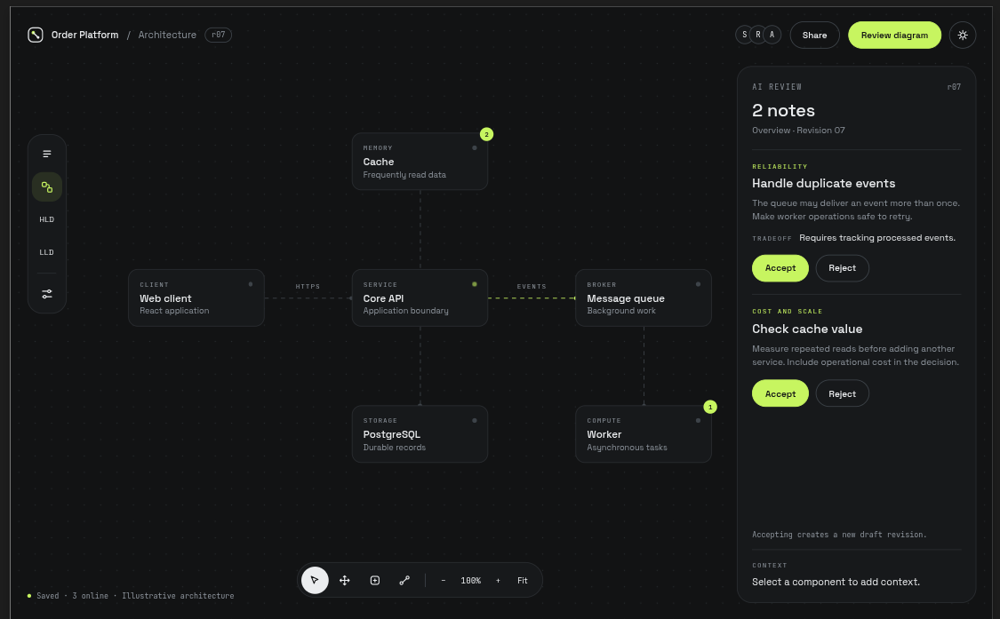
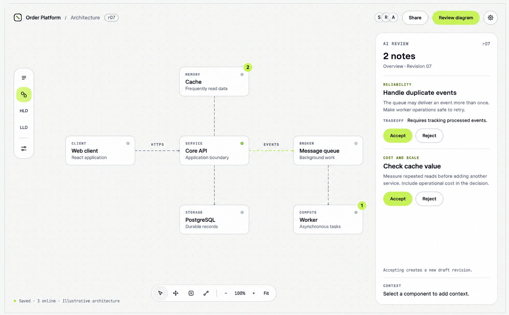
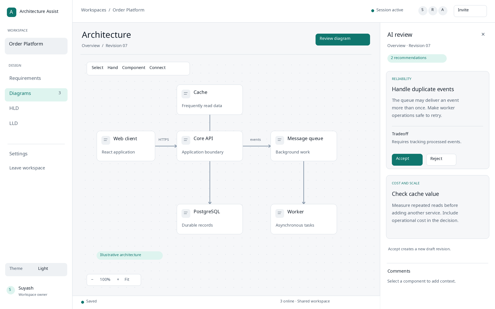
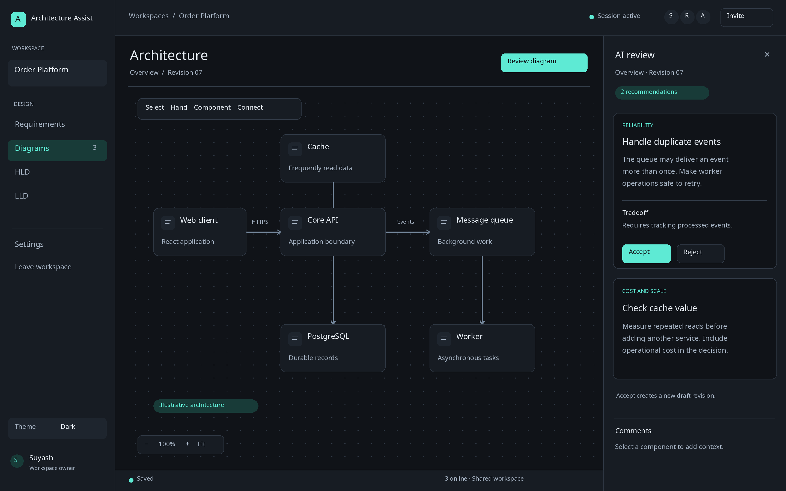
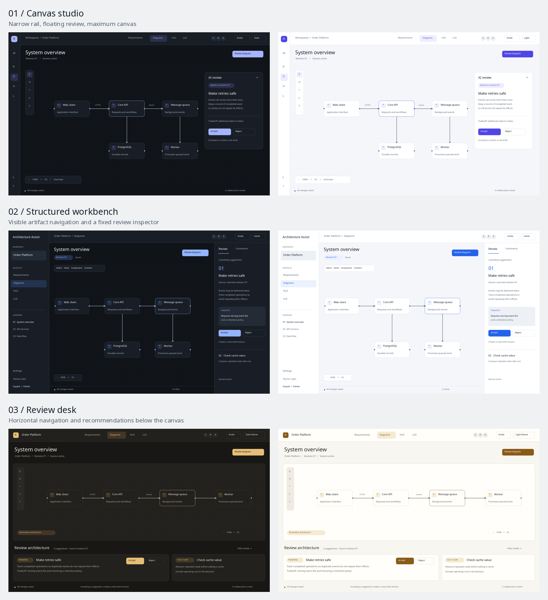

# V1 Frontend Design Proposal

**Status:** Selected HTML design implemented for the local diagram workspace. Remaining screens, backend integration, and performance budgets are still drafts.\
**Requested direction:** Minimal, modern, performance-conscious, with dark mode.\
**Existing foundation:** React, TypeScript, Vite, and React Flow as recorded in the [HLD](../hld.md). Workflows follow the [API design](api-design.md) and [database model](database-model.md).

## Selected implementation reference

The user subsequently selected the supplied **Architecture Assist Redesign.html** for implementation and supplied **Architecture Assist Redesign (1).html** as the light-mode reference. These HTML files now govern the build, superseding the earlier raster studies as implementation references. Archived copies: [first redesign](../designs/frontend-approved-redesign.html), [dark/light board](../designs/frontend-approved-redesign-light.html).

The HTML specifies Space Grotesk for interface text and JetBrains Mono for metadata. Dark colors use graphite with `#C8F560` lime; the supplied light mode uses warm ivory (`#F3F1EC`) with `#346600` green and white action text. The first frontend build in [web](../../web/README.md) follows these exact tokens, floating rail/toolbar, and right-side review panel.

Implemented scope is the interactive local diagram workspace. Backend services and remaining screens are still governed by their separate approval/design process. Local sample recommendations and storage are explicitly labeled; they do not claim live AI, authenticated sessions, or team collaboration. Earlier mockups below remain design history.

Checked build previews: [dark desktop](../designs/frontend-build-dark.jpg), [light desktop](../designs/frontend-build-light.jpg), and [390px canvas view](../designs/frontend-build-mobile.jpg). The preview shows locally retained example edits, not production workspace data.

## Preferred visual reference

The user selected the following supplied reference as the preferred visual direction on 2026-11-24. This selects the look and broad canvas layout; individual screens, interaction details, and implementation remain for discussion.

Preserve the full canvas on a near-black graphite background, subtle dotted grid, compact top breadcrumb/revision bar, floating left navigation, bottom drawing toolbar, and right-side AI review panel. Use restrained lime accents for primary actions, active tools, and numbered recommendation markers. Component cards use fine borders, small category labels, and concise descriptions. Keep the header and navigation visually lightweight.

Refinements to discuss while preserving this direction:

- Increase secondary text and line contrast where necessary; keep long review explanations comfortably readable at normal desktop scale.
- Make Requirements discoverable in compact navigation with clear labels or tooltips, alongside Diagrams, HLD, and LLD.
- Make the review panel collapsible so smaller screens and larger diagrams retain enough drawing room.
- Define numbered node markers as links to associated recommendations; explain connection colors through selection/review state rather than implying approval.
- Use text and icons alongside status color. Preserve visible keyboard focus, named toolbar actions, and an accessible way to inspect node properties.

### Matching light theme draft

The matching light counterpart preserves the reference's layout, floating controls, review panel, and lime actions. White surfaces, an off-white canvas, charcoal text, and darker slate connectors adapt the visual treatment for light mode. This is a draft for review, generated using the built-in image generation tool from the supplied reference.

The [generation prompt](../designs/frontend-preferred-light.prompt.txt) records the edit specification. The earlier light mockups below remain explorations; this new draft is the counterpart to the preferred reference.

## Shared theme behavior

Light and dark themes use the same geometry and semantic colors. Offer Light, Dark, and System preferences; use System on first visit and remember an explicit choice on that browser. Apply the theme before the first visible frame. Canvas nodes, connections, selections, and rendered documents must follow the theme too.

The following table belongs to the earlier teal palette study. It is retained for comparison; final graphite/lime theme tokens will follow the preferred reference.

| Token | Earlier light concept | Earlier dark concept |
|---|---|---|
| App background | `#F6F7F9` | `#101318` |
| Main surface | `#FFFFFF` | `#171C23` |
| Secondary surface | `#EEF1F4` | `#1E252E` |
| Border | `#DCE2E8` | `#303945` |
| Main text | `#17212D` | `#E7EDF4` |
| Secondary text | `#536171` | `#A3B0C0` |
| Action accent | `#0F766E` | `#5EEAD4` |

Color values are starting points. Validate text and control contrast, focus states, and diagram readability in both themes before adopting them. Statuses use text/icons as well as color.

## Layout options for discussion

| Option | Layout | Tradeoff |
|---|---|---|
| A — Workspace workbench, recommended | Compact left navigation; one central Requirements, Diagrams, HLD, or LLD view; contextual AI/comment panel | Keeps the requirement-to-design workflow visible and gives each artifact its own space |
| B — Canvas first | Nearly full-screen diagram with document and review drawers | Maximizes drawing space but makes requirements and document review less prominent |

These were the initial layout options. The preferred reference above now guides the next iteration: canvas focus with compact navigation and contextual review. Avoid a permanent dashboard, chat, document, and canvas all competing for space. The proposal does not add a general-purpose AI chat product.

## Concept mockups

These are static visual drafts for option A, showing the diagram view with its AI panel open. The example architecture and review content are illustrative; they do not prescribe what the user's system should contain.

Editable visual sources: [light SVG](../designs/frontend-light.svg), [dark SVG](../designs/frontend-dark.svg).

## Additional visual iterations

Three earlier layout studies keep the same workspace, diagram, source-revision, and explicit AI-decision workflow. Each has light and dark variants. They explore layout density and panel placement as well as accent colors. The user subsequently preferred the supplied reference above; these studies remain comparisons. All architecture content is illustrative.

| Direction | Layout and feel | Tradeoff | Full size previews |
|---|---|---|---|
| 01 Canvas studio | Narrow navigation rail, top artifact tabs, large canvas, floating review panel; indigo accent | Gives the diagram more space; compact navigation needs clear icons, keyboard labels, and tooltips; floating review should avoid covering selected nodes | [Dark](../designs/frontend-v1-dark.png), [Light](../designs/frontend-v1-light.png) |
| 02 Structured workbench | Visible artifact and diagram navigation, canvas in the center, fixed review inspector; blue accent | Makes workspace contents easier to discover; uses more horizontal space and needs collapsible side panels | [Dark](../designs/frontend-v2-dark.png), [Light](../designs/frontend-v2-light.png) |
| 03 Review desk | Top navigation, full-width canvas, recommendations below; warm neutral palette with amber accent | Fits team review on wide screens; the bottom panel reduces canvas height and longer recommendations need an expanded detail view | [Dark](../designs/frontend-v3-dark.png), [Light](../designs/frontend-v3-light.png) |

Direction 01 is the strongest starting point if canvas space and minimal chrome are the priority. Direction 02 is the clearest if visible requirements/document navigation matters more. Direction 03 explores a review-oriented alternative. We can combine the navigation of one with the panel behavior or palette of another after discussion.

The letter placeholders in the compact toolbar stand for select, hand, component, connection, and text; final icons and accessible labels remain part of screen design. These static assets do not establish measured performance. All three remain subject to the same deferred-loading and interaction budgets below.

SVG sources are stored alongside each PNG with the same basename. The earlier teal workbench remains available for comparison.

## Proposed screens and interactions

| Screen | Main content and action |
|---|---|
| Workspace list | Compact rows with name and the user's non-revoked session status; Create workspace; inactive collaborators return through the shared link; an enabled inactive non-revoked owner can reactivate their own session without that link |
| Shared-link entry | Sign in with an enabled account and join/reactivate a non-revoked session using the workspace's reusable `ref_id`; it is not recipient-bound; show a clear invalid-link/access-removed error |
| Requirements | One structured brief with functional/nonfunctional requirements and constraints; Save revision, Request review, and select a saved revision for generation |
| Diagrams | Named diagram list and large canvas; compact node toolbar; collaborator presence; saved/unsaved indicator; contextual review/comments |
| HLD and LLD | Readable document view with edit mode, revision selector, pinned source references, potentially stale indicator, generation status, and export |
| Settings | Theme preference; owner shared-link controls pending their API contract; reserved model connection/health area pending its API contract |

The workspace header shows its name and current view. Display revision identity, save status, pinned inputs, and potentially stale indicators. There are no document approval buttons, badges, designated approvers, or sign-off steps. Owner-only controls apply to workspace administration; the API remains the authority.

Requirements and document edits stay in a local unsaved buffer until Save revision. A `409` conflict preserves those edits and offers a comparison with the newer revision. Diagram changes use live collaboration and continuous persistence; save status changes only after durable acknowledgement.

HLD/LLD content is Markdown stored as complete immutable revision snapshots. The document view renders the selected revision's Markdown, and editing saves a new complete revision rather than mutating the selected historical content. Editor/renderer library selection and the exact save payload remain open; no document screen is implemented by this format decision.

Manual document edits retain the base revision's exact source references by default. Display those pinned requirements/diagram/HLD versions without implying that manual edits have been automatically verified. Changing sources must be explicit and creates a new revision; never silently replace references with newer versions. An LLD's requirements and diagram references are reached through its pinned HLD. Exact source-selection UI and request fields remain open.

Comments are scoped to the selected exact revision and optional diagram component/document section. Display a root comment with one level of replies; replies inherit its target rather than offering another target picker. Comments are append-only in V1, so do not show edit/delete controls. When a newer revision is selected, do not silently move old comments onto changed content. Author attribution comes from the backend's stored workspace session. Anchor selection and exact thread pagination/UI remain to be planned.

The current working diagram can be newer than its latest historical revision. Live persistence uses binary collaboration updates and consolidated working state; history contains complete immutable JSON snapshots created periodically when content changed and before AI review. Selecting a historical revision displays its snapshot read-only without altering the current working diagram. Snapshot timing, retention, and the exact history-read API remain open. The current local frontend preview does not implement this backend persistence contract.

AI review opens a contextual panel with the source revision, recommendation rationale, tradeoffs, and explicit Apply/Reject actions. Any active participant can apply a suggestion to create a new revision, with no subsequent sign-off. Keep actions attributed through the active session on the server; unapplied suggestions never silently modify saved content. Long-running generation/export shows queued/running/failed/succeeded status with bounded polling; do not block navigation while work runs.

The same workspace remains accessible through the user's active session during a network drop, but the UI shows disconnected/unsaved state until communication resumes. Explicit Leave workspace deactivates the session. The session and live presence indicators describe different things.

Owner removal is distinct from Leave: it records `revoked_at`, deactivates the session, and ends collaboration access while preserving stored attribution. A shared joining link cannot restore revoked access. React to server access removal by ending the connection and stopping workspace writes; retain local unsaved state without claiming it was saved. Hide revoked workspaces from the removed participant's normal list. Owner-removal/return UI and exact error payloads remain to be planned; the owner cannot be revoked, and no participant-facing restoration flow is selected for the initial core.

## Proposed performance approach

- Load the workspace list and shell independently of React Flow, document editing/rendering, and collaboration code. Load those features when their view opens.
- Open diagram WebSocket connections only for the diagram being edited; batch high-frequency presence updates and isolate canvas updates from document/navigation rendering.
- Fetch active-view data and paginate long lists/history. Cancel obsolete requests; keep caches scoped to the authenticated account and workspace. Clear sensitive view state when the session ends.
- Poll only outstanding operations with backoff; avoid overlapping requests and stop terminal-job polling. Treat inactive tabs and resumed views deliberately.
- Keep the UI responsive on large diagrams using bounded visible rendering and incremental updates. Establish a representative diagram size before selecting a scaling technique.
- Use CSS theme tokens, small assets, and short optional transitions. Support reduced motion; avoid remote fonts and large theme libraries for basic styling.

Proposed initial budget: at most 200 kB gzip of first-load JavaScript for the workspace list/shell, excluding deferred canvas/editor bundles. Aim for smooth canvas interaction around a 16 ms frame budget on an agreed reference diagram and laptop. These are targets to discuss and measure, not achieved results. Production load-time and diagram-size targets remain open.

## Accessibility and responsive behavior

Use visible keyboard focus, labeled controls, meaningful headings, and keyboard access to primary actions. Provide a node/property list as an alternative way to inspect and edit diagram elements. Announce save/job state changes without interrupting typing.

On desktop, the main view gets most width and the right panel opens on demand. On tablets, show one side panel at a time. For narrow screens, prioritize requirements/document reading, comments, explicit suggestion actions, and job status; the extent of phone canvas editing needs a separate scope decision.

## Proposed frontend planning sequence

1. Refine the preferred graphite/lime reference and review its light-theme counterpart.
2. Review workspace entry and session/rejoin screens.
3. Review requirements, diagram, and HLD/LLD flows, including loading/empty/error/conflict states.
4. Settle frontend state/component boundaries and the remaining API payloads, then agree on performance targets.
5. Begin implementation only after approval.

The first decision is the overall layout; this draft does not finalize every screen or introduce new frontend libraries.
